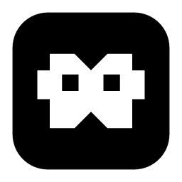
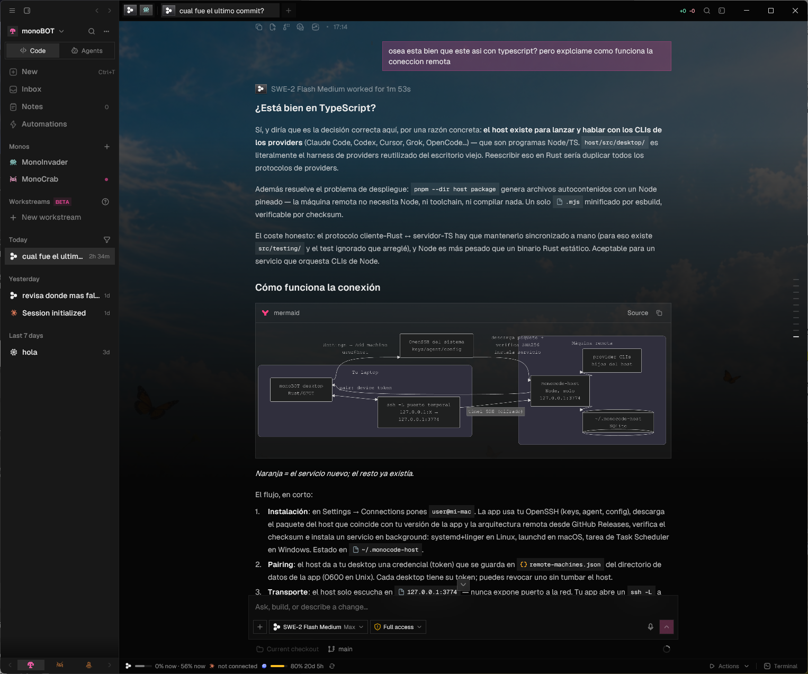
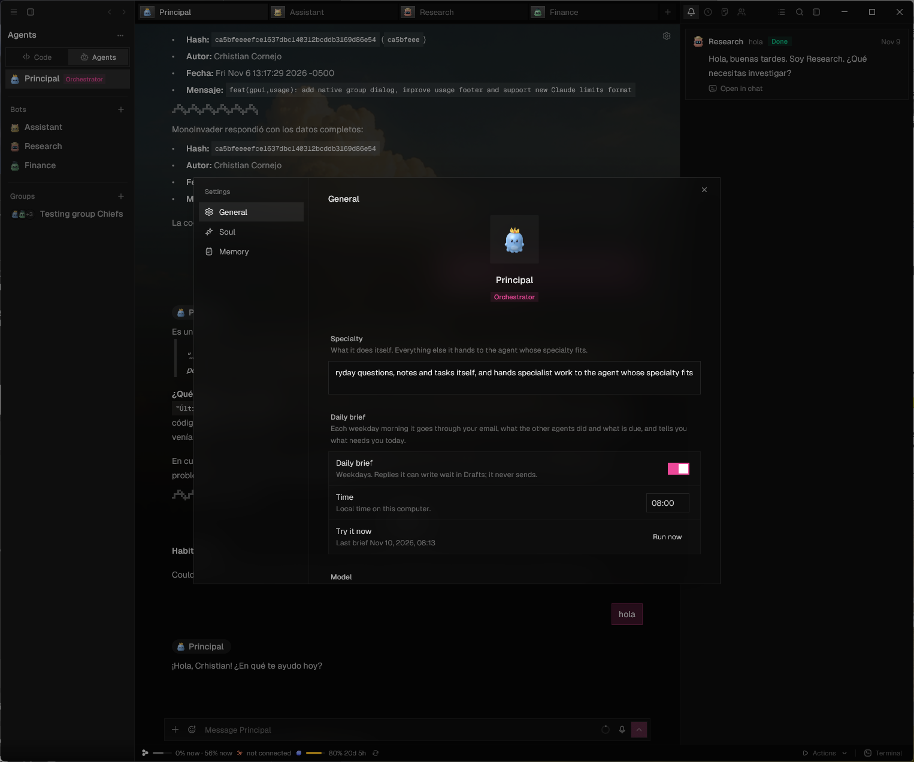
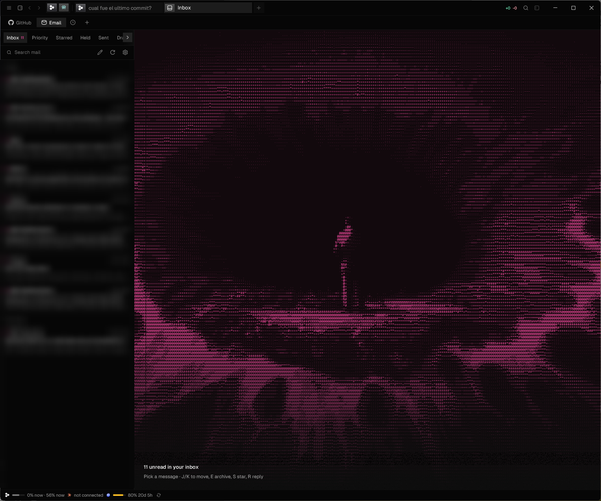
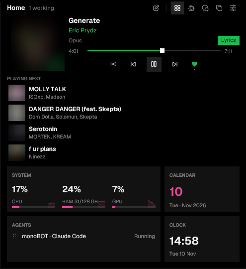

<p align="center">
  
</p>

<h1 align="center">monoBOT</h1>

<p align="center">
  <strong>One fast, native desktop app for your coding agents and your personal bots.</strong><br />
  Rust + GPUI on the desktop, Expo on your phone. No middleman servers, no extra API fees.
</p>

<p align="center">
  <a href="#download">Download</a> ·
  <a href="#features">Features</a> ·
  <a href="#quick-start">Build from source</a> ·
  <a href="docs/README.md">Docs</a>
</p>

<p align="center">
  
</p>

monoBOT is one interface for the agent CLIs you already pay for: **Claude Code, Codex, Cursor, Grok Build, OpenCode, Antigravity, Pi, omp, fx, Hermes Agent, Devin and Droid**. It runs each CLI on your machine with its own sign-in, so there are no API keys to paste and nothing sits in between. Your phone pairs with the desktop over end-to-end encrypted QUIC (TLS 1.3).

---

## Download

Installers come from monoBOT's update service on Cloudflare:

| Platform | Installer |
| --- | --- |
| Windows 10/11 (x64) | [MonoBOT setup (.exe)](https://monobot-updates.getecho.workers.dev/download/windows) |
| macOS (Apple silicon / Intel) | Coming soon: signed and notarized builds are on the way |
| Linux | Coming soon: build from source in the meantime |

The latest version and its files: [`downloads.json`](https://monobot-updates.getecho.workers.dev/downloads.json).

**Updates install themselves.** monoBOT checks when it opens and every four hours. A new version downloads in the background and is verified against monoBOT's signing key. Then it installs when you restart (on Windows, also when you quit). If an update can't finish, the sidebar offers the installer to download by hand.

---

## Features

### Coding agents, side by side
- Sessions for every supported CLI, in tabs or split views. Each one shows its model, mode, branch and usage.
- Rich replies: Markdown, syntax-highlighted code, **Mermaid diagrams** drawn natively, and **interactive visuals** (charts, calculators, 3D) that stay in the transcript (`/visualize`).
- Changes and history panes, a built-in terminal, a file explorer and editor, and native PDF, Word, Excel and PowerPoint viewers.
- `/operator` lets an agent drive monoBOT itself: start sessions, read your notes, hand off work.
- **Remote machines:** run sessions on another Windows, macOS or Linux computer over SSH. They keep running when you close the laptop.

### Agents that work for you
<p align="center">
  
</p>

- **Monos:** personal bots, each with a specialty, a *Soul* (how it behaves), long-term *Memory*, documents, habits, news and cited sources, and a 3D face that shows what it is doing.
- An **orchestrator** answers everyday questions itself and hands specialist work to the right bot. **Groups** put several bots in one conversation.
- A **daily brief** each weekday morning: your mail, what the other agents did, and what is due.
- An **Images** bot with a gallery, presets for formats and styles, and one-click edits.
- **Automations** and **workstreams** keep long-running work moving.

### Mail and inbox
<p align="center">
  
</p>

- An IMAP mail workspace with priority triage, held drafts and keyboard shortcuts (J/K, E, S, R). Bots can draft replies but never send on their own.
- Bot inboxes and an agenda, with an optional Cloudflare Email Routing Worker ([`deploy/cloudflare-mail`](deploy/cloudflare-mail/README.md)).
- GitHub and Jira Cloud inboxes beside your mail.

### The notch
<p align="center">
  
</p>

- A small panel at the top of the screen on macOS and Windows: the music you are playing and what's next, CPU/RAM/GPU, the date, the clock, and which agents are working or need you.
- It announces finished turns, and a click takes you to the chat.

### Built for speed, and to stay out of your way
- 100% native Rust with GPU rendering; no web view, no Electron.
- Local dictation (Silero + Parakeet) that switches between Spanish and English phrase by phrase, and local speech.
- Themes, palettes and an accent color; follows the system's reduced-motion setting.
- A menu-bar / tray item with your provider's usage.

---

## Quick start

### Prerequisites

- [Rust](https://rustup.rs/) (stable). The desktop app needs nothing else: its build, packaging and release tooling is a Rust crate (`cargo xtask`).
- At least one installed and signed-in agent CLI (see [providers](docs/done/providers.md)).
- [pnpm](https://pnpm.io/) and Node.js for the mobile app only.

### Desktop app (GPUI)

```bash
cargo xtask dev                              # development build on its own data; r + Enter rebuilds
cargo xtask dev --cwd /path/to/project       # open straight into a project
cargo xtask dev --fixture --chat-fixture     # add sample sessions to the development data
cargo xtask build                            # optimized build (and monoBOT.app on macOS)
cargo xtask help                             # every desktop command
```

### Mobile app (Expo)

```bash
pnpm --dir mobile install
pnpm --dir mobile start
pnpm --dir mobile ios       # iOS Simulator
pnpm --dir mobile android   # Android Emulator
```

### Releasing

Push a tag `vX.Y.Z`. The [release workflow](.github/workflows/native-release.yml) builds, signs and publishes to Cloudflare R2, and the installed apps update themselves. See [building and releases](docs/done/building.md#releases-and-updates).

---

## Architecture

- **Desktop (`crates/monocode-gpui`)**: native Rust UI on GPUI. It only draws and connects; no I/O on the UI thread.
- **Core (`crates/monocode-core`)**: provider transports, sessions, SQLite storage, git and files, bots, mail, updates and the mobile link. No GPUI.
- **Mobile (`mobile/`)**: Expo app for iOS and Android, with live sessions, a composer and project navigation.
- **Transport (`crates/mobile-link`)**: mutual TLS 1.3 over QUIC between the phone and the desktop.
- **Cloudflare Workers (`deploy/`)**: updates and downloads, and optional inbound mail.

```text
├── assets/                     # Logo (assets/logo/monobot.svg), icons, installer pictures
├── crates/
│   ├── monocode-gpui/          # Native GPUI desktop app
│   ├── monocode-core/          # Logic: providers, storage, bots, mail, updates
│   ├── mobile-link/            # QUIC/TLS pairing between desktop and mobile
│   ├── persona/                # The bots' 3D faces (desktop and mobile)
│   ├── dictation/ voice/       # Local speech-to-text and speech
│   ├── email/ http/ visual/    # Mail, HTTP/TLS, session visuals
├── mobile/                     # Expo mobile companion
├── host/                       # Remote host the desktop installs over SSH
├── deploy/cloudflare-updates/  # Update and download Worker (Rust → WebAssembly)
├── deploy/cloudflare-mail/     # Optional inbound mail Worker (Rust → WebAssembly)
├── vendor/                     # Pinned and patched GPUI
├── xtask/                      # `cargo xtask`: dev runner, builds, installers, releases
└── docs/                       # done/ (guides), in-progress/ (open work), old/ (history)
```

---

## License

monoBOT is developed by Crhistian Cornejo. It started as a fork of Monocode by Nick, also MIT-licensed, whose copyright notice is kept in [LICENSE](LICENSE) as the license requires.

[MIT](LICENSE). Provider names and logos are trademarks of their respective owners. See [NOTICE](NOTICE).
