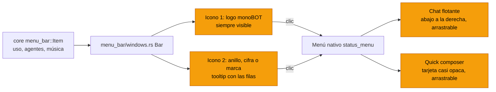
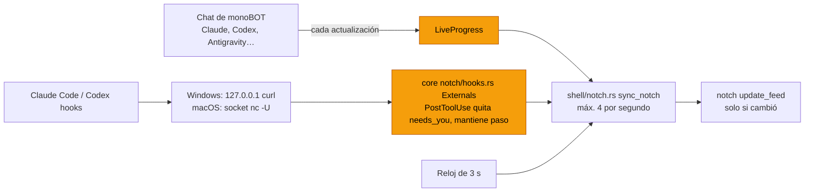
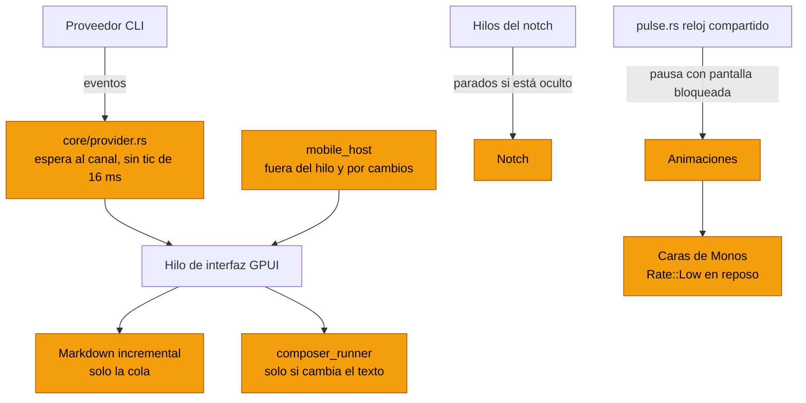
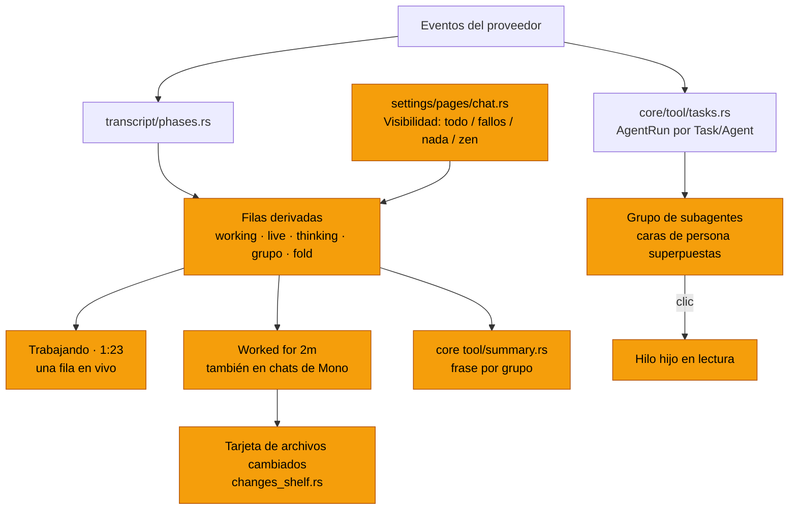
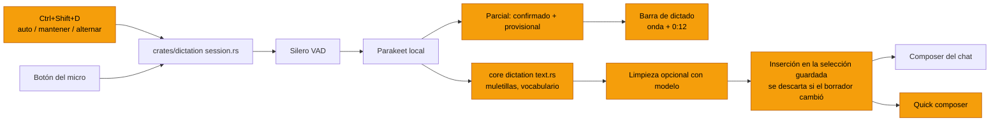
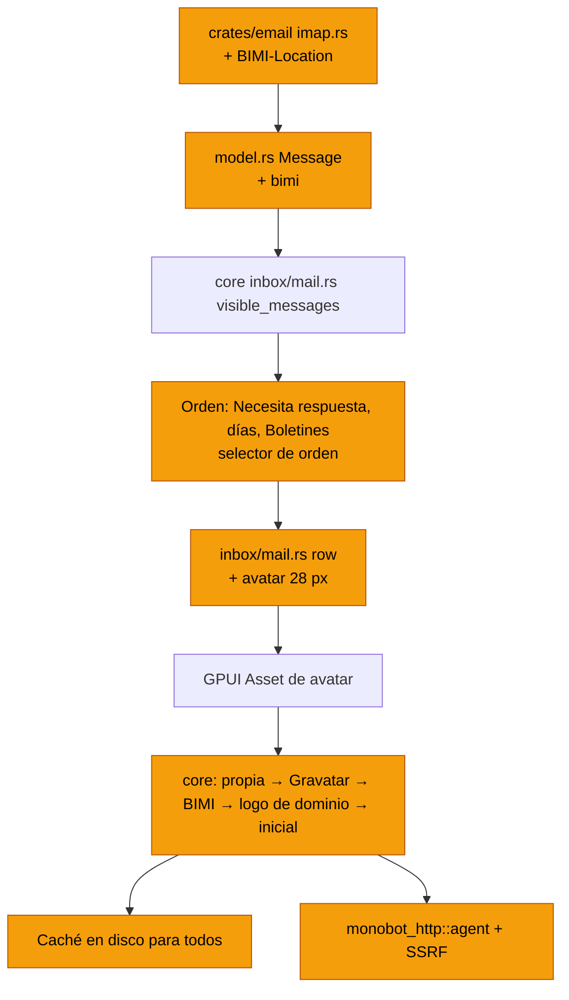
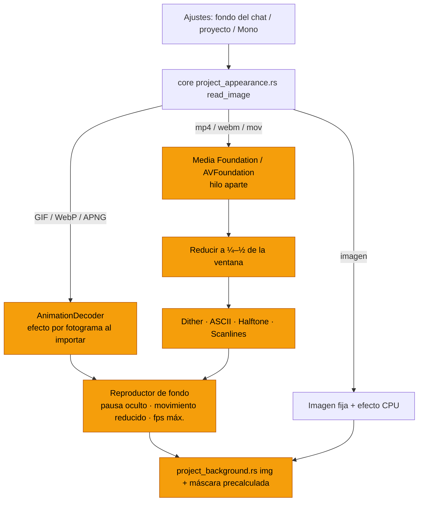
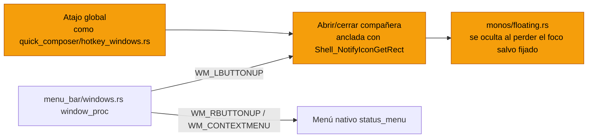
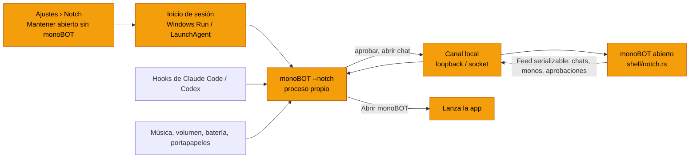

# Plan de mejoras (noviembre 2026)

Propuesta para las peticiones del 10 de noviembre. Cada punto dice qué hay hoy, qué se propone y qué archivos toca. En los diagramas, **naranja = nuevo o cambiado**; gris = lo que ya existe.

Orden recomendado (uno detrás de otro, nunca dos compilaciones de GPUI a la vez, ver la nota del final):

1. Arreglos rápidos de Windows (hecho: quick composer, chat flotante, icono al lado del logo).
2. Eficiencia: es la base de todo lo demás, sobre todo de los fondos animados.
3. Modo Focused más tranquilo + subagentes con monos.
4. Dictado al nivel de t3code.
5. Correo: avatares reales y mejor orden.
6. Fondos animados (GIF/WebP y luego vídeo 4K) con dither y demás efectos.
7. Ventana compañera desde la bandeja de Windows (estilo ChatGPT).

---

## 0. Arreglos rápidos de Windows (hechos el 10 de noviembre)

- **Quick composer sobre fondo blanco.** El acrílico de Windows no tiñe nada (`set_window_composition_attribute` con tinte `(0,0,0,0)`), así que una ventana blanca detrás se veía tal cual a través de la tarjeta al 55 % y el texto se perdía. En Windows la tarjeta ahora usa `floating_fill()` al 94 %, con la paleta activa (`quick_composer.rs`).
- **Mover el chat flotante y el quick composer.** `start_window_move()` no hace nada en Windows. El título de la cabecera del chat flotante y la tira de arrastre del quick composer ahora son `WindowControlArea::Drag`, y Windows los trata como barra de título (mover y encajar a los bordes). El chat flotante se abre abajo a la derecha, junto a la bandeja (`monos/floating.rs`).
- **"Beside the Icon" sin perder el logo.** Antes el elemento en vivo sustituía al logo en la bandeja. Ahora el logo siempre está y el elemento tiene un segundo icono propio (`menu_bar/windows.rs`, ids 1 y 2). La bandeja de Windows solo admite iconos de 16 px, así que el texto va en el tooltip y no al lado. Windows deja los iconos nuevos en el desbordamiento (^) hasta que el usuario los arrastra a la barra.

### Estados reales en el notch (hecho en parte el 10 de noviembre)

- **"Need approval" pegado.** Con Claude Code y Codex, después de aprobar un permiso, el notch seguía diciendo "Need approval" hasta la siguiente herramienta. Ahora `PostToolUse` lo quita (`core/notch/hooks.rs`).
- **Siempre "Thinking".** Al terminar cada herramienta, el notch volvía a "Thinking", mientras la ventana del agente seguía mostrando "Editando…". Ahora el notch mantiene la última acción hasta la siguiente, igual que los chats de monoBOT (`transcript.rs live_turn`). "Thinking" solo aparece antes de la primera herramienta del turno.
- **Retraso en los chats de monoBOT.** Entre un `SessionChanged` y el siguiente, el notch solo se refrescaba con el reloj de 3 s. Ahora cada actualización que llega emite `LiveProgress` y el notch se pone al día como mucho 4 veces por segundo (`conversation.rs`, `shell.rs`). El notch solo se repinta si algo cambió (`update_feed`).
- **Pendiente:**
  - Codex en Windows: el hook usa `curl.exe` y Codex solo lo ejecuta después de aprobarlo en su `/hooks`. Hay que comprobarlo en una máquina con Codex.
  - Antigravity fuera de monoBOT: no tiene hooks conocidos. Hay que investigar si expone algún evento (registro, extensión o ACP); dentro de monoBOT ya va por la vía interna.

---

## 1. Eficiencia

Fuente: `docs/in-progress/performance-audit.md` (medido solo en macOS: ~1 % de CPU y 122 MB en reposo, ~53 fps mientras llega una respuesta). Primero hay que medir en Windows con `MONOCODE_FRAME_LOG` y `memory_log`, porque allí nunca se ha medido.

| Gasto | Dónde | Cambio |
| --- | --- | --- |
| El runner del composer llama a QuickJS 60 veces por segundo durante todo el turno y nunca libera el runtime | `composer_runner.rs` | Solo cuando cambia el texto; liberar el runtime al quedar inactivo |
| El bucle del proveedor hace tic cada 16 ms aunque no llegue nada | `core/provider.rs:61`, `runtime.rs:139` | Esperar al canal (bloqueante) en lugar de sondear |
| El catálogo móvil se reconstruye cada 3 s en el hilo de la interfaz | `shell/mobile_host.rs` | Fuera del hilo y solo cuando algo cambia |
| El tic de 10 s de los Monos notifica aunque nada cambie | `monos/mod.rs:651` | Notificar solo con cambios |
| Las caras de los Monos "respiran" a 60 fps en reposo | `monos/avatar.rs:~125` | `Rate::Low` en reposo y quietas fuera de foco |
| Hilos del notch (niveles cada 0,2 s, medios cada 0,5 s) siempre vivos | `core/notch/system.rs`, `notch/platform.rs` | Pararlos con el notch oculto |
| Sondeo de notificaciones cada 1 s | `shell/notifications.rs:338` | Basado en eventos |
| Máscara del fondo en Windows: un rectángulo por fila de píxeles en cada pintado | `project_background.rs:264` | Un degradado precalculado en una imagen, una vez |
| Nada se pausa con la pantalla bloqueada; imágenes del portapapeles sin desalojar | `pulse.rs:167` | Pausar el reloj `pulse` con la sesión bloqueada; límite LRU |
| Transcripción: se rehace el markdown entero mientras llega texto | `transcript.rs` | Como t3code: cachear los bloques cerrados y reparsear solo la cola |

---

## 2. Modo Focused más tranquilo (al estilo de t3code) y subagentes con monos

**Hoy.** `transcript.rs` ya agrupa razonamiento y herramientas en fases (`transcript/phases.rs`), pliega los turnos terminados bajo "Worked for…" y tiene "Collapse tool groups". Los chats de un Mono nunca se pliegan (`transcript.rs:3585`). Un `Task`/`Agent` de Claude se pinta como tarjeta con una mascota de píxeles (`transcript/tasks.rs`, `transcript/mascot.rs`), no como Mono.

**Lo que hace t3code** (`MessagesTimeline.logic.ts`, `TimelineWorkGroupRows.tsx`, `V2SubagentGroup`):

- Mientras trabaja: una fila "Working for 1m 23s" con cronómetro, **una sola fila en vivo** con la herramienta actual ("Reading foo.ts"), una línea con el último pensamiento y nada más.
- Al terminar: todo el trabajo se pliega en "Worked for 2m" y la respuesta final queda sola. Debajo, una tarjeta "N archivos cambiados +12 −3" con "Abrir diff".
- Grupos de herramientas resumidos en una frase: "Ejecutó 3 comandos y cambió 2 archivos".
- Ajuste de visibilidad: todo / ocultar lo que salió bien / ocultar todo / zen (solo respuestas).
- Subagentes: hilos hijos fuera de la barra lateral. Varios a la vez se agrupan en "Lanzó 3 subagentes · 2 trabajando · 1 listo", con avatares superpuestos; al hacer clic se abre el hilo hijo en modo lectura. t3code no los lanza por su cuenta: son del proveedor o salen de sus herramientas MCP `delegate_task` / `task_status`.

**Hecho el 10 de noviembre:**

- **Calm work** (Ajustes › Chat, activado por defecto, en los dos layouts): mientras una respuesta trabaja, su fase queda plegada bajo una sola línea con el paso actual ("Editing src/lib.rs", "Running cargo test"). Al hacer clic se abren todos los pasos con el resumen de siempre. El "Working for…" del turno ya existía (`transcript.rs` `phase_opens`, `activity::current_step`).
- **Subagentes con cara de mono:** la mascota de píxeles pasa a ser una cara de `persona` de 16 px. La especie y el color salen del nombre del subagente, que trabajando salta y al terminar se atenúa (`transcript/mascot.rs`). Lo mismo en la pestaña Sub-agents de los bots.
- **Diagramas Mermaid con zoom:** botón "Open full size" y clic en el dibujo. Se abren en el visor de imágenes con zoom (Ctrl+rueda, pellizco, doble clic, Ctrl +/−) y arrastre. El SVG se dibuja a 4 veces su tamaño (máx. 4096 px) sobre la superficie del tema (`markdown/mermaid.rs`, `image_lightbox.rs` `Source::Svg`).

**Sigue pendiente de la propuesta:**

- Solo en Focused: cabecera "Trabajando · 1:23", una fila en vivo, la línea de pensamiento y el resto plegado. Classic se queda como está.
- Los turnos terminados se pliegan siempre, también en los chats de Mono; su panel de actividad sigue igual.
- Frase-resumen por grupo, en `core` y sin GPUI (nuevo `monocode-core/src/tool/summary.rs`).
- Tarjeta de archivos cambiados bajo la respuesta final, reutilizando `conversation/changes_shelf.rs`.
- Ajuste "Visibilidad de herramientas" en `settings/pages/chat.rs`.
- **Subagentes como monos efímeros:** cada `Task`/`Agent` recibe una cara de `persona` (la especie y el color salen del tipo de subagente, con hash estable) en lugar de la mascota de píxeles. No entran en el roster ni se guardan. Grupo plegable con caras superpuestas y estado; clic abre su tráfico (ya guardado bajo el padre en `core/provider/tasks.rs`) en modo lectura.
- Opcional: herramientas MCP `delegate_task` / `task_status` sobre `core/orchestration.rs`, para que un chat de código lance trabajadores que se vean igual.

---

## 3. Dictado al nivel de t3code

**Hoy** (`crates/dictation`, `monocode-gpui/src/dictation.rs`): local, Parakeet TDT 0.6B v3 (25 idiomas europeos), Silero VAD, resultados parciales por frase, botón del micro y Escape. No hay atajo de teclado, ni pulsar para hablar, ni dictado en el quick composer.

**Hecho el 10 de noviembre:**

- **Atajo `Ctrl+Shift+M`** (`⌘⇧M` en macOS; `Ctrl+Shift+D` ya divide el panel), reasignable en Ajustes › Atajos como "Composer: Dictate":
  - Una pulsación corta empieza o termina.
  - Mantenido más de 300 ms es pulsar para hablar: al soltar, para.
  - Si se suelta antes de que se abra el micro, para en cuanto se abre (`dictation.rs` `shortcut_down` / `shortcut_up`).
- **Reloj "0:12"** en la barra mientras escucha (`core dictation::clock`).
- **Muletillas fuera** ("eh", "mmm", "um", "uh"…), en inglés y español:
  - Una muletilla al empezar una frase le pasa la mayúscula a la palabra siguiente.
  - Si cerraba la frase, le pasa el punto.
  - Palabras con significado como «este», «o sea» o "like" se quedan (`crates/dictation/src/text.rs` `drop_fillers`).
- **Dictado en el quick composer:** micro junto al botón de adjuntar, la barra debajo y el mismo atajo. Escape primero cancela el dictado, y al ocultar el composer se suelta el micro.

**Sigue pendiente de t3code:**

- El dictado global fuera de los composers.
- Texto provisional atenuado: Parakeet da frases enteras, no palabras sueltas.
- La limpieza opcional con el modelo.

**De t3code, en orden de valor:**

1. Atajo `Ctrl+Shift+D` con modo **auto** (pulsación corta alterna; mantener más de 300 ms es pulsar para hablar), mantener o alternar. También en el quick composer.
2. Texto en vivo en dos tonos: confirmado normal y provisional atenuado, más un cronómetro "0:12".
3. Inserción segura: se recuerda la selección al empezar, se reemplaza al final con espacios en los bordes y, si el borrador cambió mientras se hablaba, no se pisa.
4. Limpieza: quitar muletillas por idioma (Spanish: "eh", "este", "o sea"…), vocabulario propio y alias (nombres de proyectos, monoBOT).
5. Limpieza opcional con el modelo, con consentimiento: puntuación, listas y correcciones habladas ("no, mejor…"). Nunca responde a lo dictado.

---

## 4. Correo: avatares reales y mejor orden

**Hoy.** Las filas (`inbox/mail.rs:1498`) no tienen avatar. Ya existe, sin usarse en la lista:

- logos de dominio (`crates/email/src/avatar.rs`, caché en disco de 30 días);
- Gravatar (`model::gravatar_url`, solo en memoria);
- el componente `inbox/avatar.rs` con la inicial de reserva.

La lista se ordena de más nuevo a más antiguo, por hilo y por día.

**Hecho el 10 de noviembre:**

- **Cada fila tiene la cara del remitente (28 px).** Primero su Gravatar; si no tiene, el logo de su organización (el `avatar.rs` que ya existía). Si no hay ninguno, su inicial sobre un color propio de la paleta.
  - Los Gravatar, y el saber que alguien no tiene, se guardan en disco (`mail-faces/`, 30 días para una foto y 7 para un "no hay"). Así al abrir la bandeja solo se pregunta por remitentes nuevos.
  - Las fotos de avatar solo se piden por `https` (`core inbox/avatar.rs`).
  - Código: `core inbox::mail::sender_face`, `inbox/mail.rs` `SenderFace`.
- **Orden de la bandeja** (`core inbox::mail::inbox_sections`):
  - Arriba, **Needs you**: sin leer, marcados como prioridad y que no son boletines.
  - Después, el resto por día.
  - Al final, **Newsletters**: el correo que trae `List-Unsubscribe`, plegado con su cuenta y los no leídos.
  - Las otras vistas y las búsquedas siguen solo por día.
- **Pendiente:** BIMI, la foto propia en Enviados y un selector de orden.

**Avatares** (cascada, todo fuera del hilo de la interfaz y en caché en disco):

1. La foto de tu propia cuenta, si el correo es tuyo.
2. Gravatar (`d=404`) para personas.
3. BIMI, el logo verificado de la marca: leer las cabeceras `BIMI-Location` en el `FETCH` de IMAP (`imap.rs:322`) o el registro DNS `default._bimi`, y rasterizar el SVG.
4. El logo del dominio (lo que ya hay en `avatar.rs`).
5. Un círculo con la inicial, en un color estable por remitente.

También: `core inbox/avatar.rs` pasa a usar `monobot_http::agent()` y la comprobación SSRF de `remote.rs`, que hoy salta. Se quita la lista de dominios gratuitos duplicada.

**Orden** (propuesta, que se puede cambiar en un selector):

- Arriba, "Necesita respuesta": prioridad y sin leer de personas reales.
- Debajo, por día como ahora.
- Los boletines (con `List-Unsubscribe` o `Precedence: bulk`) se juntan en una fila "Boletines (12)" que se despliega.
- Selector: Más recientes · Sin leer primero · Por remitente.

---

## 5. Fondos animados (GIF y vídeo 4K) con dither y demás efectos

**Hoy** (`core/project_appearance.rs`, `gpui/project_background.rs`): solo imagen fija; un GIF se queda en su primer fotograma. Se reduce a 2048 px, los efectos (Dither, ASCII, Halftone, Scanlines, Haze) se calculan en la CPU una vez y no hay ningún decodificador de vídeo.

**La clave:** dither, ASCII y halftone son estéticas de baja resolución. Se calculan a ¼ o ½ del tamaño de la ventana y se escalan sin suavizar, así que un vídeo 4K no necesita procesarse a 4K, y el coste baja 4–16 veces.

**Fase 1, hecha el 10 de noviembre:**

- **Importar:** un fondo animado (GIF, WebP o PNG animado) se guarda como su propio archivo, no como PNG del primer fotograma. Un logo sigue siendo un PNG fijo (`core project_appearance::import_image`, `is_animated`).
- **Leer los fotogramas** (`read_animation`):
  - Se reducen a 960 px de lado.
  - Caben en 64 MB. Si no, se queda uno de cada dos y su tiempo pasa al anterior, así que el ritmo se mantiene.
  - Un retardo de 0–10 ms se lee como 100 ms, igual que en los navegadores.
- **El efecto** (Dither, ASCII, Halftone, Scanlines, Haze) se aplica una vez a cada fotograma al cargar. Reproducir solo elige cuál pintar.
- **Reproducción** (`project_background.rs` `moving`, `frame_at`):
  - Va con el reloj compartido a 30 fps como máximo. El `img` de GPUI repintaría la ventana al ritmo de la pantalla.
  - Más lento con la app oculta o la pantalla bloqueada.
  - Fijo en el primer fotograma con movimiento reducido.
- **Sin probar:** no se ha visto en la app, y los tests de GPUI esperan a que el módulo `swarm` de otra sesión compile.

**Fase 2, vídeo en Windows, hecha el 10 de noviembre:**

- **Formatos:** mp4, m4v, mov, webm, mkv, avi y wmv. Se importan con un enlace duro (si la unidad no lo permite, una copia), hasta 2 GB (`core project_appearance::import_video`).
- **Decodificación** (`core video.rs`): Media Foundation decodifica y escala con el escalador del sistema, directamente a 960 px. Solo el vídeo, sin audio, en bucle y como mucho a 24 fps. Probado con un clip 4K a 30 fps generado con ffmpeg: 120 fotogramas de 960×540 en 1,4 s, con los colores y la orientación de la referencia (test `a_real_clip_decodes_scaled_and_loops`, `#[ignore]`, con `MONOBOT_TEST_VIDEO`).
- **Reproducción** (`project_background.rs` `Playback`):
  - Un hilo aplica el efecto a cada fotograma y espera su hora.
  - La vista solo cambia el fotograma que pinta y libera el anterior de la GPU.
  - Se pausa con la ventana oculta, la pantalla bloqueada o movimiento reducido; el primer fotograma siempre se muestra.
  - En memoria solo hay un fotograma, no el clip.
- **macOS:** todavía dice "Video backgrounds play on Windows for now". Falta AVFoundation (`AVAssetReader` con salida BGRA escalada), que no se puede compilar ni probar desde Windows.
- **Sin probar en la app:** los tests de GPUI esperan a que el módulo `swarm` de otra sesión compile.

**Fases:**

1. **GIF/WebP/APNG animados.** Se decodifican los fotogramas con el `AnimationDecoder` de `image`. Al importar, se aplica el efecto a cada uno en segundo plano y se guardan en caché. Se reproducen cambiando de imagen al ritmo del archivo.
2. **Vídeo (mp4/webm/mov) hasta 4K.** Se decodifica con lo que trae el sistema, sin ffmpeg: Media Foundation (`IMFSourceReader`, con aceleración por hardware) en Windows y AVFoundation en macOS. Cada fotograma se reduce y pasa por el efecto en un hilo aparte, a 24–30 fps como mucho.
3. **Solo si hace falta:** el efecto como pase de shader en los renderizadores ya parcheados (Metal y DirectX), igual que la máscara Haze de macOS.

**Reglas de consumo:**

- Pausa con la ventana oculta, minimizada o sin foco, si así se elige.
- Con movimiento reducido se dibuja un solo fotograma.
- Opción "solo con corriente".
- Límite de fps en Ajustes.

---

## 6. Ventana compañera desde la bandeja de Windows (estilo ChatGPT)

ChatGPT en Windows abre una ventana compacta pegada a la bandeja al hacer clic en su icono, y tiene un atajo global. Propuesta:

- **Clic izquierdo** en el icono: abre y cierra el chat flotante anclado encima del icono, con la posición de `Shell_NotifyIconGetRect`. Se oculta al perder el foco, salvo si está fijado.
- **Clic derecho:** el menú nativo de siempre.
- Atajo global configurable (como `Ctrl+Shift+Space` del quick composer) para abrir la ventana compañera.

---

## 7. Notch independiente de la app

Pedido el 10 de noviembre. Hoy el notch es una ventana del mismo proceso que monoBOT (`notch/mod.rs`, `shell/notch.rs`): al cerrar la app instalada desaparece.

**Propuesta:** con un interruptor en Ajustes › Notch ("Mantener el notch abierto sin monoBOT"), el notch pasa a correr como proceso propio.

- El mismo ejecutable arranca en modo notch con `monoBOT --notch`: solo GPUI con la ventana del notch, sin abrir la base de datos de sesiones ni los proveedores.
- **Arranque:** al iniciar sesión, con la entrada de inicio de Windows o el LaunchAgent de macOS que ya usa la app para iniciarse sola. También lo lanza monoBOT si no está corriendo.
- **Qué puede hacer sin la app:**
  - Leer los hooks de Claude Code y Codex: el puerto de loopback y el socket se mudan al proceso del notch.
  - Mostrar música, volumen, batería, portapapeles y estadísticas.
- **Cuando monoBOT está abierto,** se conecta al notch por el mismo canal local y le pasa sus chats, aprobaciones y monos. Cuando monoBOT se cierra, el notch se queda con lo de fuera (Claude Code, Codex) y "Abrir monoBOT" vuelve a lanzar la app.
- **Un solo dueño del puerto:** si monoBOT encuentra un notch ya corriendo, no abre el suyo y se le une. Si no lo encuentra (interruptor apagado), funciona como hoy.
- **Lo que hay que mover a `core`:**
  - El estado que hoy arma `Shell::sync_notch_now` se convierte en un `notch::Feed` serializable que monoBOT envía.
  - Las respuestas a aprobaciones vuelven por el mismo canal.

## Composio (pregunta, sin implementación)

Ver la respuesta en el chat del 10 de noviembre. En resumen: no integrarlo de forma nativa. Seguir con MCP normal, que ya admite pegar la URL de Composio con su cabecera `x-api-key`. Para Gmail, Drive, Slack y Notion, mejor los servidores MCP oficiales. Para Office en local, skills (docx/xlsx/pptx).

## Nota sobre sesiones en paralelo

En este PC no se pueden compilar dos `monocode-gpui` a la vez: se ha colgado el equipo con eso. Por eso los puntos van uno detrás de otro, en esta sesión o en una sola sesión aparte cada vez. Lo único que puede ir en paralelo es trabajo que solo compila `monocode-core` con `-j 4`.
