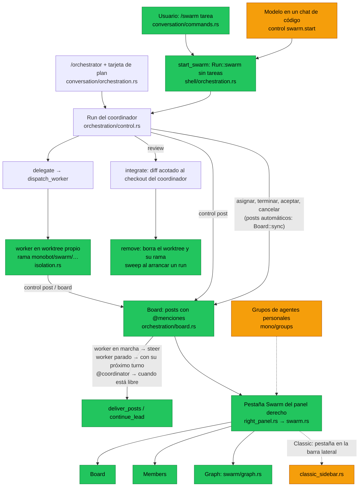

# /swarm: agentes en paralelo sobre un tablero en vivo

Plan del 2026-11-10. La idea viene del `/swarm` de Google Antigravity: un
coordinador reparte una tarea entre agentes especializados que trabajan en
paralelo y hablan en un tablero en vivo. La interfaz tiene tres pestañas:
Board, Members y Graph. monoBOT ya tenía casi todo el motor
(`orchestration::control`, worktrees aislados, integración con revisión); el
swarm añade la parte social y la vista, y no reescribe el orquestador.

## Cómo funciona

*Verde: hecho en la fase 1. Naranja: pendiente. Gris: ya existía.*

- **`/swarm <tarea>`**: el chat se convierte en coordinador. El shell abre un
  `Run::swarm` (sin tareas y sin tarjeta) y después envía el mensaje con
  `control::swarm_prompt`, que pide planificar y delegar enseguida, dar a cada
  worker un handle con su rol y añadir un verificador. Si el run no puede
  abrirse, el mensaje vuelve al compositor. Si el coordinador termina su turno
  sin delegar nada, el run se cierra solo.
- **Tablero (`orchestration/board.rs`, sin GPUI)**:
  - Miembros: `coordinator` más un handle por worker (`worker-N`, o el rol
    que el coordinador pasa en `delegate {"handle":"verifier"}`), cada uno con
    su estado: Queued, Working, Needs input, Standing by, Done, Failed o
    Cancelled.
  - `Board::sync` sigue al run y publica solo: la asignación (coordinador →
    worker), el informe final (último párrafo del resultado, worker →
    coordinador), los fallos, las aceptaciones y las cancelaciones.
  - `post`: los agentes nombran miembros con `@handle` o a todos con `@all`.
    Una mención a alguien que no existe es un error que lista los miembros.
    Guarda hasta 1.000 posts de 2.000 caracteres como máximo.
  - `inbox`: lo que se le dijo a un miembro y aún no le llegó. Solo cuentan los
    posts de los agentes; los automáticos ya llegan como tarea o resultado.
  - `graph` y `layout`: aristas por pareja (el grosor sube con el número de
    posts), `@all` expandido como aristas discontinuas, miembros que publican
    sin mencionar a nadie, y la posición de cada nodo (coordinador arriba, el
    resto en anillo). Todo puro y con tests.
- **Canal de los workers**: comparten el puente de `control`, pero un worker
  solo puede usar `post` y `board`; cualquier otra acción se rechaza. Un post
  repetido con el mismo request ID se aplica una sola vez (`Live::posted`,
  fuera del límite de 512 peticiones del run).
- **Entrega de menciones**: a un worker en marcha le llega al momento como
  `steer`; a uno parado, con su próximo turno (`dispatch_worker` añade su
  bandeja y las reglas del tablero, `control::board_instructions`); al
  coordinador, cuando está libre (`continue_lead`), dentro del mismo límite de
  20 continuaciones automáticas.
- **Ramas y limpieza**: cada worker trabaja en `monobot/swarm/<lead>-<tarea>-<ms>`.
  Al aceptarlo, su diff acotado pasa al checkout del coordinador y
  `isolation::remove` borra el worktree y la rama. Al arrancar un run,
  `isolation::sweep` borra los worktrees de workers que ningún run usa:
  enseguida si no tienen cambios y a los 7 días si los tienen. También borra
  las ramas `monobot/swarm/*` sin worktree. Nunca toca otras ramas.
- **Guardado**: el tablero se guarda en `orchestration-board:<lead>` por el
  mismo hilo de guardado ordenado que el run, solo cuando cambia, y se borra
  con la sesión. El de un run restaurado se lee de disco antes de volver a
  guardarse.
- **Pestaña Swarm (`swarm.rs`, `swarm/graph.rs`)**: aparece al final del panel
  derecho mientras el chat en vista (el coordinador o uno de sus workers)
  tiene tablero, y se abre sola al arrancar un `/swarm`.
  - **Board**: lista virtualizada que sigue el final, con búsqueda (`@handle`,
    texto), un filtro para ver solo los posts de los agentes y un separador
    «New» para lo que llegó desde la última visita.
  - **Members**: coordinador, ACTIVE, STANDING BY y FINISHED, con mascota,
    punto verde si trabaja, estado, modelo, número de su último post, tarea y
    último mensaje. Un clic abre su chat.
  - **Graph**: un solo `canvas` con curvas, flechas y nodos. Línea de tiempo
    con primero, anterior, reproducir/pausa, siguiente, deslizador y Live.
    Opciones: Hide inactive, Expand @all, ritmo uniforme o real, y velocidad
    1×/2×/4×. Debajo, la leyenda y la tarjeta del post actual.
  - El último post lanza un solo pulso; con movimiento reducido se dibuja
    resaltado y sin animación. Nada de E/S en el hilo de la interfaz.

## Estado

| Pieza | Estado |
| --- | --- |
| Core: board, `post`/`board`, `Run::swarm`, prompts, ramas, `sweep` | Hecho; `cargo test -p monocode-core orchestration` en verde (18 tests) |
| GPUI: pestaña Swarm, `/swarm`, enrutado de menciones, guardado | Hecho; `cargo check -p monocode-gpui` limpio |
| Tests de GPUI (`swarm/tests.rs`, `shell/orchestration/tests.rs`) | Escritos, **sin ejecutar**: la compilación se paró a petición del usuario |
| Probado a mano en la app (Windows y macOS) | Pendiente |

## Pendiente

1. **Ejecutar los tests de GPUI** y corregir lo que salga:
   `cargo xtask cargo test -p monocode-gpui --profile native-dev swarm`. Si
   `cargo xtask dev` está abierto, `xtask.exe` está bloqueado: usa
   `cargo test` directamente.
2. **Layout Classic**: en Classic el panel derecho no se muestra en los
   proyectos de código, así que la pestaña Swarm no se ve. Hay que añadir
   `ClassicSidebarTab::Swarm` (fuera del orden guardado, como Terminal en el
   panel), su botón en el rail compacto (`project_rail.rs`) y su panel en
   `classic_tool_pane`.
3. **Probar en la app**, en Focused y en Classic y en Windows y en macOS: un
   `/swarm` real con Claude Code y Codex, menciones entre workers, revisión,
   limpieza de ramas, y que el run se restaure tras cerrar la app.
4. **Fase 2: que el modelo decida**. Una acción `control swarm.start` (o una
   línea en las instrucciones de los chats de código) para que el modelo
   convierta su chat en coordinador cuando la tarea es grande, con un
   interruptor en Ajustes › Chat. También: modelo y harness por rol desde
   `/swarm` (por ejemplo, verificador con otro modelo).
5. **Fase 3: agentes personales**. La misma pestaña para los grupos de
   `mono/groups`: un adaptador de las rondas y menciones del grupo al
   `Board`, para que el Principal reparta una tarea larga y se vean Board,
   Members y Graph igual que en código.
6. Detalles: clic en un nodo del grafo para abrir su chat; arrastrar el
   deslizador fuera de su caja; mostrar en Members cuánto lleva cada worker.

## No objetivos

- No se cambian la revisión ni la integración: el trabajo de un worker sigue
  entrando por diff acotado, nunca por `git merge`, porque el checkout del
  coordinador puede tener cambios sin commit.
- Los workers no hacen commit ni push; el coordinador decide qué se acepta.
