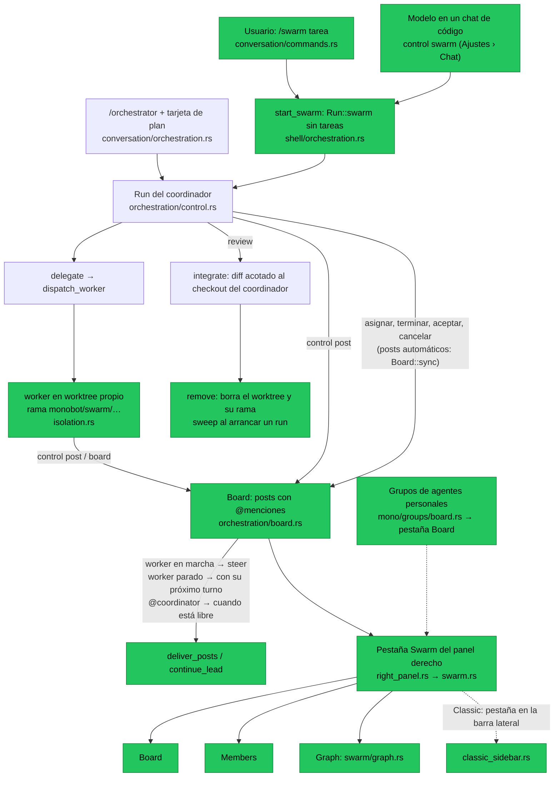
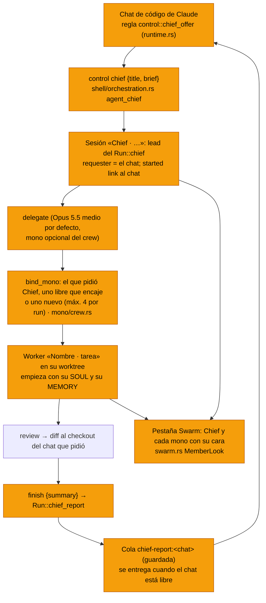

# /swarm: agentes en paralelo sobre un tablero en vivo

Plan del 2026-11-10. La idea viene del `/swarm` de Google Antigravity: un
coordinador reparte una tarea entre agentes especializados que trabajan en
paralelo y hablan en un tablero en vivo. La interfaz tiene tres pestañas:
Board, Members y Graph. monoBOT ya tenía casi todo el motor
(`orchestration::control`, worktrees aislados, integración con revisión); el
swarm añade la parte social y la vista, y no reescribe el orquestador.

## Cómo funciona

*Verde: hecho (fases 1 a 3). Gris: ya existía.*

- **`/swarm <tarea>`**: el chat se convierte en coordinador. El shell abre un
  `Run::swarm` (sin tareas y sin tarjeta) y después envía el mensaje con
  `control::swarm_prompt`, que pide planificar y delegar enseguida, dar a cada
  worker un handle con su rol y añadir un verificador. Si el run no puede
  abrirse, el mensaje vuelve al compositor. Si el coordinador termina su turno
  sin delegar nada, el run se cierra solo.
- **Tablero (`orchestration/board.rs`, sin GPUI)**:
  - Miembros: `coordinator` más un handle por worker (`worker-N`, o el rol
    que el coordinador pasa en `delegate {"handle":"verifier"}`), cada uno con
    su estado: Queued, Working, Needs input, Standing by, Done, Failed o
    Cancelled.
  - `Board::sync` sigue al run y publica solo: la asignación (coordinador →
    worker), el informe final (último párrafo del resultado, worker →
    coordinador), los fallos, las aceptaciones y las cancelaciones.
  - `post`: los agentes nombran miembros con `@handle` o a todos con `@all`.
    Una mención a alguien que no existe es un error que lista los miembros.
    Guarda hasta 1.000 posts de 2.000 caracteres como máximo.
  - `inbox`: lo que se le dijo a un miembro y aún no le llegó. Solo cuentan los
    posts de los agentes; los automáticos ya llegan como tarea o resultado.
  - `graph` y `layout`: aristas por pareja (el grosor sube con el número de
    posts), `@all` expandido como aristas discontinuas, miembros que publican
    sin mencionar a nadie, y la posición de cada nodo (coordinador arriba, el
    resto en anillo). Todo puro y con tests.
- **Canal de los workers**: comparten el puente de `control`, pero un worker
  solo puede usar `post` y `board`; cualquier otra acción se rechaza. Un post
  repetido con el mismo request ID se aplica una sola vez (`Live::posted`,
  fuera del límite de 512 peticiones del run).
- **Entrega de menciones**: a un worker en marcha le llega al momento como
  `steer`; a uno parado, con su próximo turno (`dispatch_worker` añade su
  bandeja y las reglas del tablero, `control::board_instructions`); al
  coordinador, cuando está libre (`continue_lead`), dentro del mismo límite de
  20 continuaciones automáticas.
- **Ramas y limpieza**: cada worker trabaja en `monobot/swarm/<lead>-<tarea>-<ms>`.
  Al aceptarlo, su diff acotado pasa al checkout del coordinador y
  `isolation::remove` borra el worktree y la rama. Al arrancar un run,
  `isolation::sweep` borra los worktrees de workers que ningún run usa:
  enseguida si no tienen cambios y a los 7 días si los tienen. También borra
  las ramas `monobot/swarm/*` sin worktree. Nunca toca otras ramas.
- **Guardado**: el tablero se guarda en `orchestration-board:<lead>` por el
  mismo hilo de guardado ordenado que el run, solo cuando cambia, y se borra
  con la sesión. El de un run restaurado se lee de disco antes de volver a
  guardarse.
- **Pestaña Swarm (`swarm.rs`, `swarm/graph.rs`)**: aparece al final del panel
  derecho mientras el chat en vista (el coordinador o uno de sus workers)
  tiene tablero, y se abre sola al arrancar un `/swarm`.
  - **Board**: lista virtualizada que sigue el final, con búsqueda (`@handle`,
    texto), un filtro para ver solo los posts de los agentes y un separador
    «New» para lo que llegó desde la última visita.
  - **Members**: coordinador, ACTIVE, STANDING BY y FINISHED, con mascota,
    punto verde si trabaja, estado, modelo, número de su último post, tarea y
    último mensaje. Un clic abre su chat.
  - **Graph**: un solo `canvas` con curvas, flechas y nodos. Línea de tiempo
    con primero, anterior, reproducir/pausa, siguiente, deslizador y Live.
    Opciones: Hide inactive, Expand @all, ritmo uniforme o real, y velocidad
    1×/2×/4×. Debajo, la leyenda y la tarjeta del post actual.
  - El último post lanza un solo pulso; con movimiento reducido se dibuja
    resaltado y sin animación. Nada de E/S en el hilo de la interfaz.

## Fases 2 y 3 y detalles (10 de noviembre)

- **Layout Classic.** `ClassicSidebarTab::Swarm` aparece al final de la tira
  de pestañas y en el rail compacto (icono `users`) mientras el chat en vista
  tiene tablero. No entra en el orden guardado ni se arrastra, y no se guarda
  como pestaña del proyecto. Un `/swarm` nuevo la abre sola; cuando el tablero
  se va, la barra vuelve a Sessions (`shell/classic_sidebar.rs`,
  `shell/project_rail.rs`, `sync_swarm`, `reveal_swarm`).
- **Que el modelo decida** (Ajustes › Chat › «Let agents start swarms»,
  apagado por defecto):
  - Un chat de código con el ajuste encendido recibe una vez por conversación
    del proveedor la regla `control::swarm_offer` (como las reglas de
    Operator, con `Introduction`), en `runtime.rs`.
  - `control swarm {"title":"…"}` convierte el chat en coordinador a mitad de
    turno: el shell abre el `Run::swarm` y la respuesta trae las reglas del
    run (`control::swarm_started`), así que el modelo delega en ese mismo
    turno. Repetida, devuelve el swarm que ya abrió. Un worker, un chat de
    Mono o uno remoto no pueden; con el ajuste apagado, el error dice dónde
    se enciende (`shell/orchestration.rs` `agent_swarm`).
- **Harness y modelo por rol desde `/swarm`.** Las palabras del principio
  `@rol=harness` o `@rol=harness/modelo` fijan ese rol, por ejemplo
  `/swarm @verifier=codex @tester=claude/opus Migrar auth`
  (`control::swarm_roles`).
  - Al abrir el run se comprueba que el harness y el modelo existen
    (`Run::check_roles`); si no, el mensaje vuelve al compositor con el
    motivo.
  - `delegate` con ese handle rellena harness y modelo y rechaza otros. El
    prompt del coordinador nombra los roles fijados.
- **Grupos de agentes personales** (pestaña **Board** del panel de un grupo,
  entre Members y Call):
  - `mono/groups/board.rs` convierte el chat del grupo en un `Board`. El
    mensaje del usuario sale del Principal a todos o a quien nombre con @, la
    respuesta de cada miembro le reporta al Principal (y a quien nombre) y la
    última palabra del Principal va a todos.
  - Board, Members y Graph son la misma vista (`SwarmPanel`). La cabecera dice
    «Idle» en lugar de «Finished» cuando nadie contesta.
  - Un clic en un miembro abre su asiento en el grupo (`Route::Session`).
  - El tablero solo se rehace si cambió el chat o quién contesta.
- **Detalles:**
  - Un clic en un nodo del Graph abre el chat de ese miembro; bajo el
    puntero el nodo se resalta.
  - El deslizador de la línea de tiempo sigue al ratón fuera de su caja y
    suelta donde se suelte el botón (`window.on_mouse_event` en captura).
  - Members muestra cuánto ha trabajado cada miembro, sumando sus tramos en
    Working o Needs input (`Member::worked`, `board::duration`). Mientras
    alguien trabaja y la pestaña está a la vista, se repinta una vez por
    segundo.

## Chief y los monos de código (11 de noviembre)

Un chat de código de Claude puede pasarle una tarea grande a **Chief**, un
mono que coordina a los monos de código del usuario en su propio chat. El
chat que pidió el trabajo recibe un único resumen cuando termina. Usa el
motor del swarm; lo nuevo es quién lidera y quién trabaja.

*Naranja: nuevo.*

- **Cuándo se ofrece.** Ajustes › Chat › «Let Claude hand work to your
  monos», encendido por defecto. Un chat de código de Claude (no un mono, ni
  un worker, ni uno remoto) recibe la regla una vez por conversación del
  proveedor. Los subagentes nativos de Claude siguen disponibles para leer e
  investigar rápido; Chief es para trabajo en paralelo que cambia código.
- **Chief** es un bot con el rol oculto `chief` (gorra de capitán), creado la
  primera vez. Su sesión trabaja en el checkout del chat que pidió el trabajo
  y aparece colgada de él en la barra lateral.
- **Los monos de código** son bots con el rol oculto `coder` (casco amarillo)
  y se quedan con el usuario: Chief los reutiliza en tareas futuras por nombre
  (`"mono"` en `delegate`) o la app elige uno libre cuya especialidad encaje.
  Solo crea uno nuevo si no hay libre, hasta 4 por run. Su worker es una
  sesión de código normal (no un chat de bot, que tiene las ediciones
  recortadas) titulada con su nombre, y su primer turno empieza con su SOUL y
  su MEMORY (`crew::identity`).
- **Modelo:** `Defaults::chief` elige Opus 5.5 del catálogo de Claude (o el
  alias `opus`) con esfuerzo medio si lo ofrece. Sin Claude instalado, el
  harness y el modelo del chat que pidió.
- **El informe:** `finish` exige `summary` en un run de Chief. Al terminar o
  pararse el run, `chief_report` se guarda en `chief-report:<chat>` y se
  entrega como turno interno cuando ese chat está libre, nunca encima de un
  turno o un borrador del usuario.

## Arreglos del 12 de noviembre

- La tarjeta de un run de swarm (o de Chief) dice **Swarm**, no
  «Orchestrator», y mientras el coordinador planifica explica que los agentes
  aparecen al delegar, en vez de quedar vacía.
- **Open board** (antes «Open agents») abre la pestaña Swarm aunque todavía no
  haya workers y aunque el usuario haya cerrado el panel: en Focused abre el
  panel derecho, en Classic la barra lateral. Arrancar un swarm también abre el
  panel en el siguiente render, que es el que tiene la ventana.
- El coordinador y Chief leen solo lo necesario para repartir (unos archivos,
  un par de minutos) y delegan enseguida; cada worker lee lo que su parte pide.

## Estado

| Pieza | Estado |
| --- | --- |
| Core: board, `post`/`board`, `Run::swarm`, prompts, ramas, `sweep` | Hecho; tests de `orchestration` en verde |
| Core: tiempo por miembro, roles fijados, `control swarm`, tablero de grupos | Hecho; `orchestration` y `mono::groups` en verde (114 tests) |
| GPUI: pestaña Swarm, `/swarm`, enrutado de menciones, guardado | Hecho |
| GPUI: Classic, `control swarm`, roles, nodos y deslizador, Board de grupos | Hecho; tests en `swarm/tests.rs`, `shell/orchestration/tests.rs` y `monos/tests.rs` |
| Probado a mano en la app (Windows y macOS) | Pendiente |

## Pendiente

1. **Probar en la app**, en Focused y en Classic y en Windows y en macOS:
   - un `/swarm` real con Claude Code y Codex, con un rol fijado;
   - menciones entre workers, revisión y limpieza de ramas;
   - que el run se restaure tras cerrar la app;
   - un chat con «Let agents start swarms» encendido que decida abrir uno;
   - la pestaña Board de un grupo con varios miembros contestando.
2. El tiempo de trabajo empieza a contar en esta versión: los tableros
   guardados antes no tienen tramos y muestran solo lo trabajado desde ahora.

## No objetivos

- No se cambian la revisión ni la integración: el trabajo de un worker sigue
  entrando por diff acotado, nunca por `git merge`, porque el checkout del
  coordinador puede tener cambios sin commit.
- Los workers no hacen commit ni push; el coordinador decide qué se acepta.
