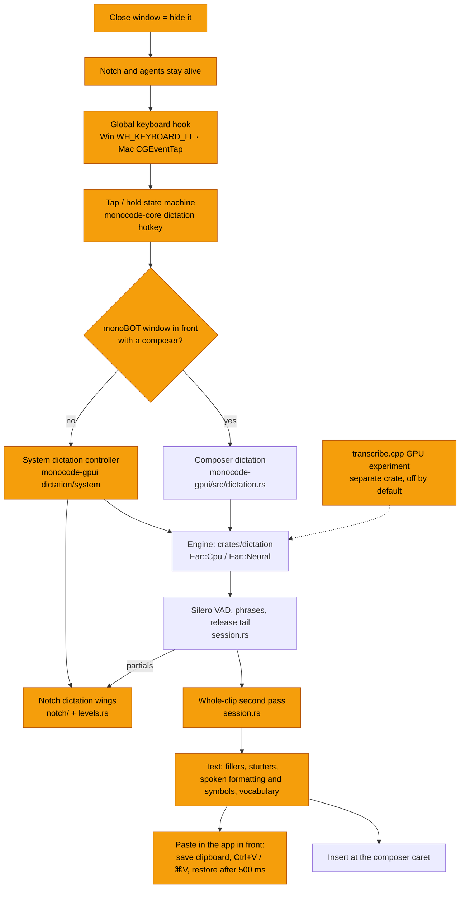
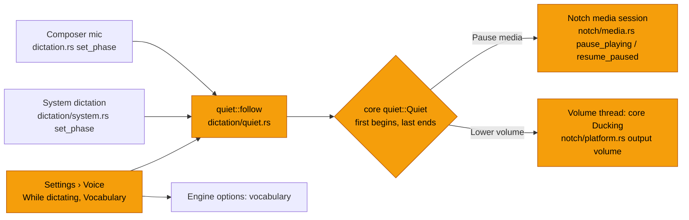

# System dictation and an always-on notch

Status: in progress (started 2026-11-11). Phases 0, 1, 2, 3 and 5 are
built and tested on Windows (unit tests and the GPUI test bench; not yet
tried by hand in the real app). All macOS code is written but has not been
compiled. Phase 4 (transcribe.cpp) has not started. See "Where it stands"
at the end. Ideas taken from studying Hex (`Ref_projects/hex`, MIT); the
code here is our own, not copied.

## Goal

- One global shortcut (Ctrl+Space by default, rebindable). Tap toggles,
  hold is push to talk (the composer's 300 ms rule).
- When a monoBOT window is in front with a composer, the shortcut dictates
  into that composer, as today.
- Anywhere else it dictates into the app in front: the notch shows the
  dictation (right wing: mic, level bars, "Dictating"; left wing: the words
  as they arrive, with motion that reduced motion turns off) and the text is
  pasted where the caret was. The notch never takes focus while dictating.
- Closing the main window hides it instead of quitting, on Windows and
  macOS, so the notch and the agents keep running. Quit is Ctrl+Q / ⌘Q or
  the tray / menu bar.
- Same engine everywhere: `crates/dictation`.

Ctrl+Space conflicts: macOS uses it to switch input sources, Windows uses it
for the IME, and editors (VS Code…) use it for completion. Settings warns
about this next to the shortcut.

## What was found (2026-11-11)

- `main.rs` quits when only notch windows are left
  (`notch::only_notches_left`), and the notch belongs to the main window's
  `Shell` (`shell/notch.rs`), so closing the window ends the notch.
- `shell.rs` hides instead of closing only on macOS, and only with the menu
  bar icon on and at least one mono. Windows always quits.
- The quick composer's global shortcut (Carbon `RegisterEventHotKey`,
  Windows `RegisterHotKey`) reports presses only, not releases, so it cannot
  do push to talk. The notch already has a Windows `WH_KEYBOARD_LL` hook
  (volume keys) and asks for Accessibility on macOS.
- `session.rs` flushes the voice detector the moment dictation stops, which
  clips the last syllable. Downloads restart from zero when cut
  (`model.rs` `File::create` on `.part`).

## Diagram

Orange: new or changed.

## Phases

0. **Engine quality** (`crates/dictation`, no new dependencies): release tail
   (200 ms, up to 600 ms while speech goes on), a whole-clip second pass
   when the dictation fits the model's window, fillers (`er`, the comma a
   filler leaves), stutters («el el informe»), spoken formatting («nuevo
   párrafo», "new line", «abre/cierra comillas») and spoken symbols
   («arroba», «guion bajo», «punto y coma», «dos puntos», "at sign"…), user
   vocabulary replacements, resumable downloads.
1. **The notch outlives the window**: close hides on both OSes, reopen from
   the notch, tray, Dock or taskbar.
2. **One global shortcut and its router**: press and release from the
   existing hooks, the state machine in `monocode-core`, composer vs system.
3. **System dictation in the notch** and paste into the app in front, with
   "Copied" and Paste last when nothing could take it.
4. **transcribe.cpp (GPU) experiment**: a crate outside the workspace, off by
   default, plus a benchmark of sherpa CPU vs Vulkan on the same Spanish
   WAVs. On this PC: CMake (winget) and the Vulkan SDK are installed. The SDK
   went in without admin via the installer's `copy_only=1` mode into
   `%USERPROFILE%\VulkanSDK` (no registry changes), with `VULKAN_SDK` and
   `...\Bin` set in the user environment.
   Build it once, `CMAKE_BUILD_PARALLEL_LEVEL=4`, `cargo -j 4`, never next to
   a GPUI build (or point `TRANSCRIBE_DIR` at a prebuilt copy). First check
   whether Parakeet v3 streams in transcribe.cpp; only Unified English and
   Nemotron are known to.
5. **Extras**: pause or lower media while dictating, Paste last history,
   vocabulary biasing inside `neural.rs`'s TDT decoding (macOS).

## Build safety

One GPUI build at a time, `-j 8` at most; core-only crates `-j 4`. Phase 4
never runs next to another build.

## Done so far

- Pure logic in `monocode-core` (`crates/monocode-core/src/dictation/`):
  `hotkey.rs` (the `Shortcut`, its text and conflict warnings, the tap /
  hold `PressMachine`), `route.rs` (composer or system), `paste.rs` (the
  paste plan, Ctrl+V / ⌘V, restore after 500 ms if the clipboard is still
  ours, "Copied", Paste last history of 20) and `system.rs` (the notch's
  phase and the left wing's words). Not wired into the app yet.
- Phase 1, the notch outlives the window: with Settings › General › "Keep
  monoBOT running in the background when the window closes" on (stored as
  `close_to_tray`, default on), closing the window hides it on macOS and
  Windows (`monocode_core::app_window::on_close`,
  `monocode-gpui/src/app_window.rs`), so the shell and the notch stay. The
  notch, the tray's Open, notifications, the Dock (macOS, `on_reopen`) and a
  second launch (Windows: a named event per data folder) show it again;
  Ctrl+Q / ⌘Q also quit with no workspace window in front. Two small GPUI
  patches (see `docs/done/architecture.md`).
- Phases 2 and 3a, the global shortcut, its router and the paste (nothing
  painted in the notch yet):
  - The shortcut is the Keybindings command "App: Dictate Anywhere"
    (default Ctrl+Space, stored as a GPUI keystroke in `keybindings`), and
    Settings › Voice › "Dictate in other apps" turns it on or off
    (`dictate_anywhere`, default on) and shows the clash warning. The
    user's vocabulary is `dictation_vocabulary` (no editor yet); composers
    and system dictation both pass it to the engine (`Engine::start_with`).
  - `monocode-gpui/src/dictation/keyboard.rs`: Windows `WH_KEYBOARD_LL` on
    its own thread, macOS a session `CGEventTap` on its own run loop thread
    (needs Accessibility; retried every 3 s). Both run
    `monocode_core::dictation::keycodes::Filter`: the key only with exactly
    its modifiers, its repeats and release, Escape only while a system
    dictation listens; an Alt or Win chord sends VK 0xE8 so the modifier
    alone opens no menu. Keys the app sends carry a marker and pass.
  - `monocode_core::dictation::route::Router`: a focused composer in front
    gets the press through its own `Dictate` action (and the release
    through `shortcut_up`), a monoBOT element that binds the same keys (the
    code editor's completion) gets the keystroke, anything else starts the
    system dictation, whose press rule then owns the next press.
  - `monocode-gpui/src/dictation/system.rs`: the `SystemDictation` entity
    (global `SystemDictations`, `system::get(cx)`) with `phase()` (core
    `system::Phase`), `levels()`, `history()`, `paste_last()`. It pastes
    with the core plan (Ctrl+V / ⌘V after the modifiers are up, restore
    after 500 ms) or copies when nothing in front takes text.
- Phase 3b, the notch paints it (`monocode-gpui/src/notch/dictating.rs`):
  the notch observes the `SystemDictation` entity and keeps a copy of its
  phase and levels. While a dictation shows it takes the wings ahead of
  notices, levels, agents and music (the open panel still wins, and hovering
  does not open the panel over it): the right wing has the mic, the newest
  12 level bars and "Dictating" in the accent ("Starting…", "Finishing…"
  dimmed); the left wing has the newest words, which fade in while the row
  glides toward the camera, with the oldest leaving under a fade on the far
  edge (reduced motion draws the final state). The words' wing grows in
  48 pt steps up to 192 pt, so the island moves a few times per dictation.
  Pasted (check), Copied (the chord to paste) and errors show a mark and
  their words, then fold, and the agents' wings come back. Without a camera
  (Windows' pill, the island) it is one row. "Paste last dictation" is a
  button in the open panel's header (once something was dictated) and
  "Paste Last Dictation" in the tray / menu bar menu; with nothing dictated
  yet the notch says so.
- Phase 5 extras, both opt-in, in Settings › Voice:
  - "While dictating" (`while_dictating`: Do nothing by default, Pause
    media, Lower volume) applies to the composer's mic and the system
    dictation, not to a call's mic. `monocode_core::dictation::quiet`
    decides: the first dictation to listen quiets, the last one to end
    (stopped, cancelled, failed or its composer closed) puts it back. Pause
    sends the notch's own media session a toggle for each player that
    plays (`Notch::pause_playing`), and plays again only those still
    paused (`resume_paused`), so a player the user started meanwhile keeps
    playing. Lower takes the output to 30 % of its level on a thread of its
    own (`notch::output_volume` / `set_output_volume`: the Windows audio
    endpoint, CoreAudio on macOS) and puts it back only if it is still the
    level it set. Wiring: `monocode-gpui/src/dictation/quiet.rs`.
  - "Vocabulary": two fields (as dictation writes it → as it should read)
    and the list, each entry with a bin. `monobot_dictation::add_replacement`
    tidies the entry and lets the same words (as matching sees them) take a
    new spelling in place. Stored in `dictation_vocabulary`, which both
    dictation paths already pass to the engine.

Orange: new in Phase 5.

## Where it stands (review of 2026-11-11)

| Phase | State | Where |
| --- | --- | --- |
| 0. Engine quality | Done, unit tested | `crates/dictation`: `session.rs` (release tail, whole-clip second pass), `text.rs` (fillers, stutters, vocabulary), `spoken.rs` (spoken formatting and symbols), `model.rs` (resumable downloads) |
| 1. The notch outlives the window | Done on Windows, macOS not compiled | `monocode-core/src/app_window.rs`, `monocode-gpui/src/app_window.rs`, `shell.rs`, two vendored GPUI patches |
| 2. Global shortcut and router | Done on Windows, macOS not compiled | `monocode-core/src/dictation/{hotkey,keycodes,route}.rs`, `monocode-gpui/src/dictation/keyboard.rs` |
| 3. System dictation, notch and paste | Done on Windows, macOS not compiled | `monocode-core/src/dictation/{paste,system}.rs`, `monocode-gpui/src/dictation/system.rs`, `notch/dictating.rs` |
| 4. transcribe.cpp (GPU) experiment | Toolchain ready, bench crate set up (outside the repo), not built | Blocked on the models: this network's proxy answers 403 for huggingface.co. See "Model mirror" below |
| 5. Extras | Pause or lower media, vocabulary editor and Paste last done; vocabulary biasing inside `neural.rs` not started | `monocode-core/src/dictation/quiet.rs`, `monocode-gpui/src/dictation/quiet.rs`, Settings › Voice |

Fixed in the final review:

- A taken Escape keeps its release even when dictating in other apps is
  turned off while Escape is down. Before this, the hook's filter forgot
  the Escape and swallowed the next unrelated Escape
  (`keycodes::Filter`, with a test).
- A paste runs in its own task, so a dictation that finishes during it no
  longer drops it before the clipboard is put back. "Paste last" does
  nothing while a paste is still waiting to restore the clipboard, so it
  never saves our own text as the user's (`dictation/system.rs`).

Not verified:

- **macOS, none of it compiled** (this was built on Windows, and
  `cargo check --target aarch64-apple-darwin` stops at C build scripts
  such as `ring`):
  - the `CGEventTap` thread and its re-enable;
  - `CGEventPost` ⌘V, and the Accessibility retry every 3 s;
  - the assumption that `cx.active_window()` is `None` while another app
    is in front;
  - Dock reopen (the vendored `should_handle_reopen` patch, and
    `app_window::on_reopen`);
  - hiding through `traffic_lights::hide`;
  - the CoreAudio `set_output_volume`, and pausing media through
    MediaRemote.

  macOS's own Ctrl+Space (switching input sources) may take the key
  before the tap sees it.
- **Windows, not tried by hand:**
  - the low-level hook, the swallowing and the VK 0xE8 Alt/Win mask;
  - the `SendInput` paste and the clipboard restore;
  - `has_paste_target` in Electron, UWP and console windows;
  - an elevated app in front: UIPI drops the paste silently, so it
    reads Pasted;
  - closing to the background and coming back from the tray, the notch,
    a notification or a second launch;
  - the COM endpoint on the "dictation-volume" thread.
- **Clipboard:** the restore puts back only text and images (what GPUI's
  `ClipboardItem` reads), and our text also lands in Windows' clipboard
  history (Win+V).
- **Missed key-up:** if the system never delivers the shortcut's key-up
  (for example Win+L while holding it), the next press of that key alone
  is swallowed once, and that ends the stuck state.
- **Composer releases:** with the hook on, a composer gets its release
  through the `Pressed` global. This was tested only on the test platform.
- **Volume pop-up:** lowering the volume during a composer dictation
  flashes the notch's volume pop-up at the start and at the end.
- **Linux:** there is no hook and no notch. Ctrl+Space dictates only
  inside a composer, through the in-window binding. Closing the window
  quits, as before. The Linux build was not compiled here; the code is
  gated with `cfg` so it should build.

## Benchmark (2026-11-11)

Word error rate (WER): the share of words that differ from what should have
been written, so **lower is better** (0 % is perfect). Measured on the
user's own recordings, against the text each phrase should end as (fillers
gone, commands applied). Lot 1 is 14 Spanish phrases (`es-*`), lot 2 is 15
Spanish phrases full of English terms (`mx-*`). Speed is milliseconds of
work per second of audio, on the CPU (32 cores, 4–8 threads).

| Engine | Lot 1 (Spanish) | Lot 2 (Spanish + English) | Speed |
| --- | --- | --- | --- |
| Parakeet v3, CPU, before this work | 16.6 % | 39.7 % | ~40 ms/s |
| Parakeet v3, CPU, with Phase 0's text cleanup | 13.0 % | 36.7 % | ~40 ms/s |
| Whisper large-v3-turbo, CPU, with the cleanup | 12.1 % | 30.7 % | ~250 ms/s |

- The cleanup fixed fillers, stutters, «nueva línea», quotes and part of
  the spoken symbols. A vocabulary list built from the same recordings got
  lot 1 to 10.5 %, but that is tuned on the test itself.
- Lot 2's figures include three bad recordings: mx-01 is 0.5 s of silence,
  mx-12 was cut short and mx-13 clips at 0 dBFS. Re-record them.
- What still fails is English said with a Spanish accent and names:
  GPUI → «GPU», Rust → «RAS», README → «Rhythm», Claude → «Claudio» or
  «Cloud», monoBOT → «Mondobot». Whisper gets more of these right
  (README, Quick Start Guide, Claude, Sonnet, ¿…?) but is about 7× slower
  on the CPU, which is why Phase 4 now matters for quality, not just speed:
  Whisper turbo on the GPU (RTX A4000 here) with the vocabulary as its
  prompt.
- sherpa-onnx's hotwords (decoder biasing) do not work with Parakeet: a
  small boost changes nothing, a large one makes it repeat the hotwords.
  Dropped.
- Realistic targets: about 4–6 % for plain Spanish and 7–10 % for Spanish
  with English terms, with Whisper on the GPU, its prompt, the vocabulary
  and the text rules below.

The bench lives outside the repo, in `D:\dev\dictation-bench`
(`frases*.json`, `grabar.ps1`, `tools/`, `results_*.json`). The cleanup is
measured with the real code through
`crates/dictation/src/bench_tests.rs` (ignored by default).

## Model mirror (the proxy blocks Hugging Face)

This office network answers 403 for every huggingface.co URL, so the GGUF
models cannot be downloaded here, and neither could users behind a similar
proxy. Plan:

1. From a Mac (or any network that reaches Hugging Face), download the
   pinned files and check their SHA-256:
   - `handy-computer/parakeet-tdt-0.6b-v3-gguf` @ `85ac09ea…`,
     `parakeet-tdt-0.6b-v3-Q8_0.gguf`, 739,508,576 bytes,
     sha256 `5859f779…802cc7`;
   - `handy-computer/whisper-large-v3-turbo-gguf` @ `d222c9f6…`,
     `whisper-large-v3-turbo-Q8_0.gguf`, 886,381,824 bytes,
     sha256 `d5e65f2b…17448`.
2. Upload them to the R2 bucket the updates Worker already serves
   (`deploy/cloudflare-updates/`), under `models/<file>`, and add a
   `/models/<file>` route there. GitHub release assets are a fallback, but
   GitHub caps a file at 2 GB, and the Worker is ours already.
3. `crates/dictation/src/model.rs` tries Hugging Face first and the mirror
   second, the same way it already falls back to GitHub for Parakeet's CPU
   build, keeping the SHA-256 check (the files are byte for byte the same).

## Remaining

- Phase 4: the model mirror above, then build `D:\dev\dictation-bench\gpu`
  once (`transcribe-cpp = "=0.4.1"`, feature `vulkan`,
  `CMAKE_BUILD_PARALLEL_LEVEL=4`, `cargo -j 4`, alone) and run Parakeet and
  Whisper turbo on the GPU over both lots. If Whisper on the GPU wins, add
  it to `crates/dictation` as a third engine (off by default; Settings ›
  Voice picks Parakeet for speed or Whisper for English terms), with the
  vocabulary as its prompt.
- Text rules: e-mail addresses («juan arroba ejemplo punto com» →
  `juan@ejemplo.com`: today the @ joins only the next word), file names
  («session punto rs» → `session.rs`), and, as an option, numbers written
  as digits («quince de noviembre» → «15 de noviembre», «tres y media» →
  «3:30»).
- Learn from corrections: when the user edits a dictated word in the
  composer, offer to add it to the vocabulary.
- Optional later: fine-tune Whisper (LoRA) on the user's voice; needs 1–2
  hours of transcribed recordings.
- Phase 5: vocabulary biasing inside `neural.rs`'s TDT decoding (macOS).
- A Cancel button on the notch (Escape cancels today) and a hint that
  shows `shortcut_label`.
- Prompting for Accessibility from the dictation itself (today it uses
  whatever the notch asked).
- Settings › Voice does not refresh its Accessibility note live.
- Once checked by hand on both systems, describe the feature in
  `docs/done/desktop.md` and move this document to `docs/done/`.
