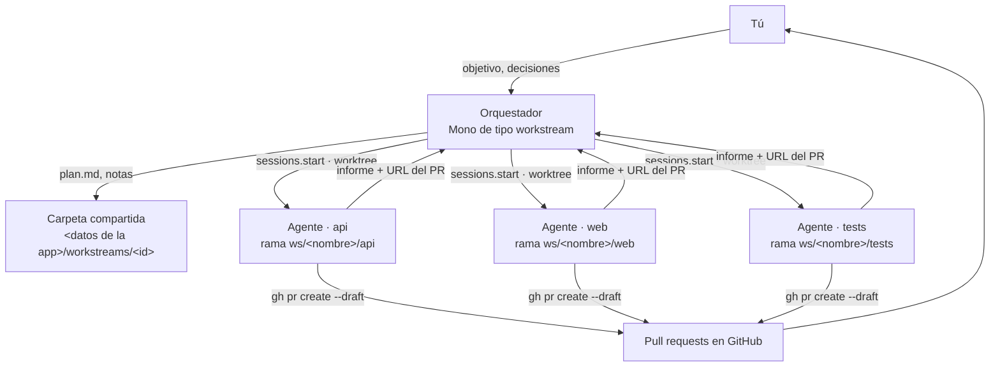

# Workstreams (beta)

> Las rutas `src/` y `src-tauri/` de este documento son de la app Tauri, que ya no está en el repositorio (se conserva en la etiqueta local de git `archive/tauri-app`). Lo que falta portar está en [tauri-gap-audit.md](tauri-gap-audit.md).

Un workstream es para trabajo que le tomaría días a un equipo: una migración, una función que toca el front y el back, una tanda de bugs. Tú le das el objetivo a un **orquestador**. El orquestador lo divide en partes, lanza un **agente** por parte para que trabajen a la vez, y te devuelve el resultado como **pull requests**.

Cuándo no usarlo: para un cambio de un solo archivo o una tarea de una hora, una sesión normal es más rápida y gasta muchos menos tokens.

## Cómo funciona



- **El orquestador** es un Mono más: tiene su chat, su memoria y sus hábitos. No escribe código; planifica, reparte y coordina. Sus instrucciones salen de `workstreamBrief` en `src/features/workstreams/model/workstreams.ts` (Tauri).
- **Cada agente** es una sesión normal, abierta en un **worktree propio** del repositorio. Así nunca pisa los archivos de otro. Trabaja en la rama `ws/<nombre>/<parte>` y termina abriendo un **pull request en borrador**.
- **La carpeta compartida** guarda lo que no es código: el plan (`plan.md`), notas, hallazgos y entregables. En Windows está en `%APPDATA%\com.monocode.desktop\workstreams\<id>`.
- **Todo corre en tu ordenador.** Si cierras MonoBOT, el orquestador y los agentes se detienen.

## Antes de empezar

1. El proyecto debe ser un repositorio git con un remoto en GitHub.
2. Ten `gh` instalado y con sesión iniciada (`gh auth status`). Los agentes lo usan para abrir sus PRs.
3. Si el repo tiene varios remotos (por ejemplo, `origin` es tu copia y `upstream` el original), dile a `gh` cuál es el tuyo. Si no lo haces, `gh` elige `upstream` y los agentes abrirían sus PRs en el repo de otra persona:

   ```bash
   gh repo set-default crhistian-cornejo/monoBOT
   ```

   El Inbox de MonoBOT ya usa `origin` por su cuenta. Este comando también sirve para `gh` en la terminal y para los agentes.

## Crear un workstream

1. En el panel izquierdo, zona **Code**, sección **Workstreams** (marcada como Beta), pulsa **+**.
2. La primera vez aparece un recorrido de 4 pasos. Puedes saltarlo.
3. Rellena el diálogo:
   - **Name**: qué se va a lograr, en pocas palabras. De ahí sale el nombre de las ramas (`ws/<nombre>/…`), que el diálogo te muestra mientras escribes.
   - **Goal** (opcional): qué tiene que ser cierto al terminar, cómo se comprueba y qué no hay que tocar. Se le envía al orquestador como primer mensaje y empieza a planificar en ese momento. Si lo dejas vacío, se lo explicas luego en el chat.
   - **Repository**: el proyecto en el que trabajarán los agentes.
   - **Orchestrator runs in**: en **su propio worktree** (recomendado: tus archivos abiertos no se tocan) o en **la carpeta del proyecto**. Los agentes siempre tienen su propio worktree, elijas lo que elijas.
4. Pulsa **Start workstream**. Se abre el orquestador con su panel.

## Usarlo

| Pestaña | Qué muestra |
| --- | --- |
| **Agents** | Las sesiones que lanzó el orquestador, agrupadas en *Waiting on you*, *Working* e *Idle*. Abre cualquiera para ver lo que hace o para responderle. |
| **PRs** | Los PRs de las ramas `ws/<nombre>/…`, agrupados en Open, Draft, Merged y Closed. |
| **Files** | La carpeta compartida: el plan, las notas y los entregables. |

Cómo sacarle partido:

- **Acuerda el plan antes de que lance agentes.** El orquestador te pregunta por el resultado, cómo se va a verificar y qué decisiones quieres tomar tú. Lo deja escrito en `plan.md`.
- **Pon reglas fijas en el chat**, por ejemplo "cada PR con tests y un resumen en español". El orquestador las aplica a todos los agentes desde ese momento.
- **Responde solo cuando te lo pidan.** Un agente o el orquestador te avisa cuando una decisión es tuya; lo demás lo coordinan entre ellos.
- **Revisa y fusiona los PRs** como cualquier otro, desde GitHub o desde el Inbox.

## Límites actuales

- Solo local: no hay orquestador remoto, y se detiene al cerrar la app.
- Si cierras la app, los agentes no se reanudan solos. Sus worktrees y ramas siguen ahí, así que puedes pedirle al orquestador que los retome.
- Un workstream gasta muchos más tokens que una sesión, porque hay un modelo por cada agente.

## Qué se podría mejorar

| Mejora | Idea | Dónde iría |
| --- | --- | --- |
| Tablero de agentes | Una fila por agente con su parte, su rama, el estado del PR y los checks de CI, en lugar de tener Agents y Pull requests por separado. | `src/features/workstreams/ui` |
| CI dentro del workstream | Mostrar los checks de cada PR y ofrecer "arreglar CI", reutilizando `InboxPrChecks` y `ciRepair` del Inbox. | `src/features/inbox` → `WorkstreamPrs` |
| Reglas guardadas | Las reglas que dictas se guardan en `rules.md` de la carpeta compartida y se le pasan a cada agente nuevo. | `workstreamBrief` |
| Presupuesto | Un máximo de agentes a la vez y de tokens por workstream, con un botón para pausar todo. | `monoHabits` / ajustes del Mono |
| Reanudar | Un botón "Reanudar" que vuelve a abrir los agentes desde sus worktrees después de cerrar la app. | `workstreamApi.ts` |
| Informe diario | Un hábito del orquestador que resume el avance en Novedades. | hábitos de Mono, que ya existen |
| Orquestador remoto | Ejecutarlo por SSH con el acceso remoto que ya tiene la app, para que siga trabajando con tu portátil apagado. | `src-tauri/src/remote_ssh.rs` |
