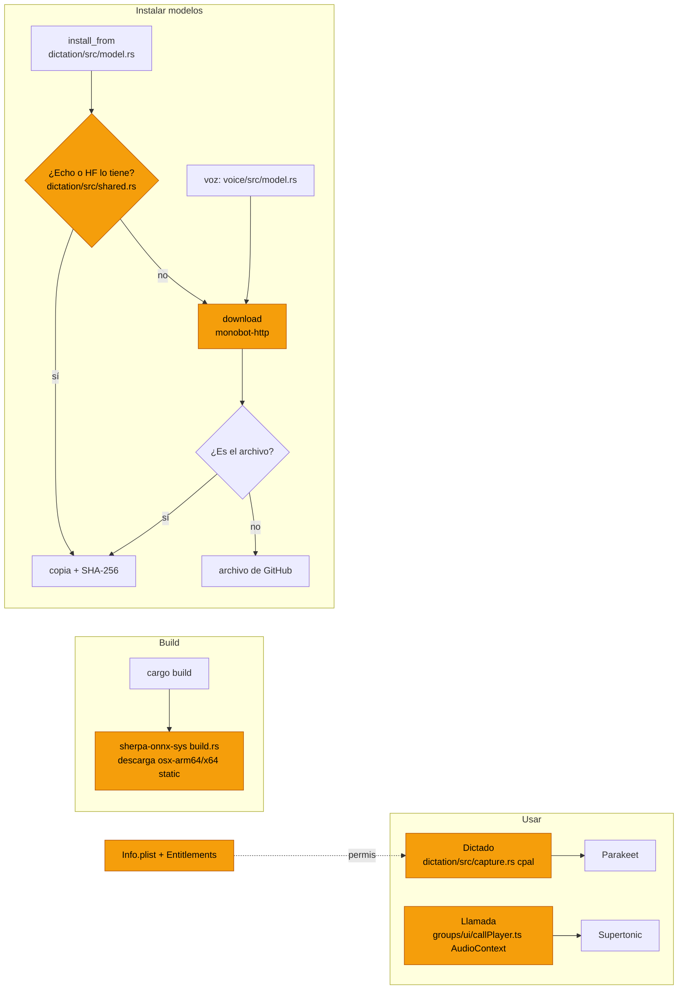

# Qué revisar en macOS

El dictado (Parakeet + Silero), las voces de las llamadas de grupo (Supertonic 3), la copia de
modelos desde Echo y las descargas detrás de un proxy de empresa se hicieron y probaron en
Windows. Nada de eso se ha probado todavía en un Mac. Esta lista dice qué mirar, por qué y cómo.

Estado del código revisado: `rebrand` en `4f395546` más `d2432e3d` (descargas detrás del proxy).

## Resumen

| # | Qué | Estado en el código | Gravedad |
|---|-----|---------------------|----------|
| 1 | Permiso de micrófono | `NSMicrophoneUsageDescription` y `com.apple.security.device.audio-input` añadidos; sin probar en un Mac | Era bloqueante para el dictado |
| 2 | Certificados en descargas | En Mac se usan las raíces que trae la app, no el llavero (`crates/http/src/lib.rs`) | Bloqueante solo detrás de un proxy que inspecciona TLS |
| 3 | Compilar sherpa-onnx | Su `build.rs` descarga la librería estática de GitHub | Igual que en Windows: falla detrás del proxy |
| 4 | Modelos de Echo | Busca en `~/Library/Application Support/Echo*/voice` y `~/.cache/huggingface/hub` | Revisar |
| 5 | Captura de audio | cpal sobre CoreAudio, cualquier formato de 8 a 192 kHz | Revisar |
| 6 | Sonido de la llamada | `AudioContext` en WKWebView, creado en el clic que inicia la llamada | Revisar |
| 7 | Interfaz | Barra de título `Overlay` con semáforos; diseños Classic y Focused | Revisar |
| 8 | Intel y universal | Una librería estática por arquitectura | Revisar si se distribuye universal |



Naranja: puntos con comportamiento propio de macOS que hay que revisar.

## 1. Permiso de micrófono

**Qué pasaba.** macOS exige una frase en `NSMicrophoneUsageDescription` antes de dejar que una app
abra el micrófono. Sin ella, el sistema cierra la app en cuanto lo intenta. Además, Tauri 2 firma
con hardened runtime por defecto, y con hardened runtime hace falta el entitlement
`com.apple.security.device.audio-input`. Sin él, macOS no pide permiso y el micrófono no da audio.
MonoBOT no tenía ninguna de las dos; Echo tiene ambas (`apps/macos/Resources/Info.plist` y
`Echo.entitlements`).

**Arreglo aplicado:**

```xml
<!-- src-tauri/Info.plist -->
<key>NSMicrophoneUsageDescription</key>
<string>MonoBOT turns what you say into text while dictation or a group call is listening. The audio never leaves this Mac.</string>

<!-- src-tauri/Entitlements.plist -->
<key>com.apple.security.device.audio-input</key>
<true/>
```

La frase va en inglés, como las demás del `Info.plist`.

**Cómo verificar.**
- [ ] Construir el `.app` (`pnpm tauri build`, ver [building.md](building.md)) y abrirlo desde Finder, no
      desde la terminal: con `pnpm tauri dev` el permiso se le puede atribuir a la terminal y ocultar el fallo.
- [ ] Pulsar el botón de dictado: debe salir el aviso de macOS con la frase de arriba.
- [ ] Aceptar y dictar en español y en inglés.
- [ ] Denegar (`tccutil reset Microphone com.monocode.desktop` para volver a preguntar) y comprobar
      que la app muestra un error y no se cierra.
- [ ] Comprobar en Ajustes del Sistema → Privacidad → Micrófono que aparece MonoBOT.

## 2. Certificados en las descargas

**Qué pasa.** `monobot-http` usa el verificador del sistema solo en Windows
(`#[cfg(windows)]` en `crates/http/src/lib.rs`). En Mac se queda con las autoridades que trae la
app (webpki). Echo hace lo mismo en Rust (`crates/base/src/tls.rs`). Detrás de un proxy como
Netskope, que firma con una autoridad instalada en el llavero, todas las conexiones de la app fallan
con `invalid peer certificate: UnknownIssuer`. Eso incluye los modelos, Azure DevOps, GitLab, Jira,
Linear y las vistas previas de enlaces.

**Arreglo propuesto.** Quitar el `cfg(windows)` para que el Mac también use
`rustls-platform-verifier` (Security.framework, que confía en el llavero). Sus dependencias para Mac
(`security-framework` 3.7.0, `core-foundation` 0.10.1) ya están en `Cargo.lock`, así que no entran
versiones nuevas.

**Cómo verificar.**
- [ ] En una red normal: `cargo test -p monobot-http -- --ignored` (llega a GitHub).
- [ ] Detrás del proxy de la empresa, si el Mac lo tiene: el mismo test. Hoy debería fallar con
      `UnknownIssuer`; con el arreglo, pasar.
- [ ] `cargo test -p monobot-http`: el test que comprueba el verificador hoy solo corre en Windows;
      con el arreglo debe correr también en Mac.

## 3. Compilar sherpa-onnx

**Qué pasa.** `sherpa-onnx-sys` 1.13.8 enlaza estático por defecto y, al compilar, descarga
`sherpa-onnx-v1.13.8-osx-arm64-static-lib.tar.bz2` (o `osx-x64` en Intel) desde GitHub. Enlaza
además `c++` y el framework `Foundation`. Detrás del proxy, esa descarga falla igual que en
Windows.

**Cómo verificar.**
- [ ] `cargo build -p monobot-dictation -p monobot-voice` compila y enlaza.
- [ ] Detrás del proxy: bajar el archivo a mano, descomprimirlo y apuntar
      `SHERPA_ONNX_LIB_DIR=<carpeta>/lib`, como se hace en Windows.

## 4. Copiar los modelos de Echo

**Qué pasa.** En Mac, `crates/dictation/src/shared.rs` busca en
`~/Library/Application Support/{Echo, Echo Dev, Echo Nightly}/voice`, en `$ECHO_DATA_DIR/voice` y
en la caché de Hugging Face (`$HF_HUB_CACHE`, `$HF_HOME/hub` o `~/.cache/huggingface/hub`). Las
rutas de Echo coinciden con `crates/base/src/paths.rs` de Echo.

**Cómo verificar.**
- [ ] Con Echo instalado y su modelo de dictado descargado:
      `cargo test -p monobot-dictation -- --ignored --nocapture takes_the_real_model_from_this_computers_echo`.
- [ ] En la app: el aviso de instalar dictado debe ofrecer usar el modelo de Echo y terminar sin descargar.
- [ ] Sin Echo: el aviso debe ofrecer la descarga normal.

## 5. Captura de audio (cpal sobre CoreAudio)

**Qué pasa.** `crates/dictation/src/capture.rs` toma el micrófono por defecto con su formato propio
(f32, i16 y otros; de 8 a 192 kHz) y lo pasa a mono; la sesión trabaja a 16 kHz.

**Cómo verificar.**
- [ ] Micrófono interno del Mac.
- [ ] AirPods u otro micrófono Bluetooth (suelen bajar a 16 o 24 kHz y cambiar de perfil al abrirse).
- [ ] Cambiar el micrófono por defecto con el dictado abierto, y cerrar la tapa: la app no debe quedarse colgada.
- [ ] El indicador de nivel se mueve al hablar.

## 6. Sonido de la llamada de grupo

**Qué pasa.** `src/features/groups/ui/callPlayer.ts` crea un `AudioContext` dentro del clic que
inicia la llamada (`useGroupCall.ts`, `start`). WebKit solo deja sonar audio que nace de un gesto del
usuario, así que debería funcionar, pero WKWebView no se ha probado.

**Cómo verificar.**
- [ ] Iniciar una llamada: se oyen las voces, en español y en inglés, cada miembro con su voz.
- [ ] Parar a mitad de frase: el sonido se corta.
- [ ] Iniciar una segunda llamada sin recargar: vuelve a sonar.
- [ ] Velocidad de Supertonic en Apple Silicon: en Windows, 2,85 s de audio tardaron 0,6 s.
      `MONOBOT_VOICE_DIR=$(mktemp -d) cargo test -p monobot-voice -- --ignored --nocapture`
      instala el modelo desde cero, habla e imprime los tiempos.

## 7. Interfaz

La ventana usa `titleBarStyle: "Overlay"` con `hiddenTitle`, así que los semáforos del Mac quedan
sobre el contenido. Cambios recientes tocaron la barra de título y los controles de la ventana
(`a9b7810b`, `576c129b`).

- [ ] Diseños Classic y Focused: nada queda tapado por los semáforos, y la ventana se puede
      arrastrar desde la barra.
- [ ] Panel de la llamada de grupo en ambos diseños.
- [ ] Botón y barra de dictado en el compositor de Mono (`MonoComposer.tsx`) y en la llamada
      (`GroupCall.tsx`), en ambos diseños.
- [ ] Barra de progreso al instalar los modelos: avanza siempre y termina en 100 %.

## 8. Intel y binario universal

`sherpa-onnx-sys` descarga una librería por arquitectura. Un build universal
(`--target universal-apple-darwin`) compila dos veces y necesita las dos.

- [ ] Si se distribuye universal: el build termina y la app arranca en Apple Silicon y en Intel (o con Rosetta).

## 9. Mantener el equipo despierto

`src-tauri/src/keep_awake.rs` declara a mano las funciones de IOKit (`IOPMAssertionCreateWithName`,
`IOPMAssertionRelease`) y de CoreFoundation. Solo se ha compilado y probado en Windows.

- [ ] `cargo test -p monocode --lib keep_awake` compila, enlaza IOKit y pasa.
- [ ] Con un agente trabajando, `pmset -g assertions` muestra `PreventUserIdleSystemSleep` con el nombre "MonoBOT has agents working".
- [ ] Al terminar el turno, la aserción desaparece. También desaparece al desactivar Ajustes → General → "Keep computer awake".

## Tests a correr en el Mac

```bash
cargo test -p monobot-http -p monobot-dictation -p monobot-voice
```

```bash
cargo test -p monobot-http -- --ignored
```

```bash
cargo test -p monobot-dictation -- --ignored --nocapture downloads_through_this_network
```

```bash
cargo test -p monobot-dictation -- --ignored --nocapture installs_through_this_network
```

```bash
MONOBOT_VOICE_DIR=$(mktemp -d) cargo test -p monobot-voice -- --ignored --nocapture
```

`installs_through_this_network` baja unos 1,2 GB (en Windows, detrás de Netskope, tardó 56 s).
