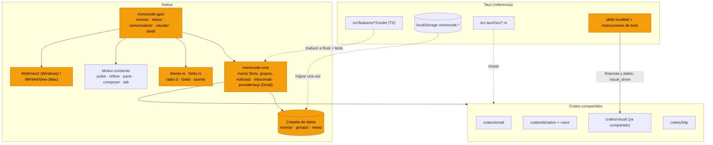

# Plan: llevar MonoBOT a la app nativa (GPUI)

Inventario: los 97 commits de Crhistian Cornejo del 4 y 5 de noviembre de 2026, de
`d4c53c31` a `7ecab6e2`, más este plan. Referencia de comportamiento: la app Tauri
(`src/`, `src-tauri/`). La nativa tiene que quedar **igual que Tauri**: mismas
funciones, mismos textos, mismo estilo y misma motion. Destino: `crates/monocode-core`
para la lógica y `crates/monocode-gpui` para la interfaz.

## Cómo está hoy

- La nativa es Rust de punta a punta. No comparte código con Tauri: `monocode-core`
  está fuera del workspace de Tauri y `src-tauri` no depende de él. La única
  excepción es `crates/visual`, que ya usan las dos apps.
- Casi toda la lógica de bots, grupos, noticias y delegaciones vive en TypeScript
  (`src/features/*/model`, `src/integrations/harness`) y guarda su estado en
  `localStorage` (`monocode.botNews`, `monocode.delegations.v`, `monocode.groupLearned`…).
  La nativa solo lee ese `localStorage`, y no lo escribe.
- Ya existen como crates de Rust independientes y se enlazan tal cual:
  `crates/email` (IMAP/SMTP, triage, caché, búsqueda), `crates/dictation`,
  `crates/voice`, `crates/visual`, `crates/http` y `crates/mobile-link`.
- La nativa ya tiene: Monos con alma, memoria, hábitos y latido; orquestación;
  documentos; visuales con gráficos tramados (`monocode-gpui/src/visuals/charts.rs`,
  de donde salió el port SVG de Tauri); Inbox de GitHub, GitLab, Jira, Linear y
  Azure DevOps; notas; automatizaciones; 11 proveedores (Droid no está); skills de
  `.agents/skills` y `.claude/skills`; terminal alacritty.
- Compila y arranca en Windows (comprobado el 5 de noviembre: 13 min la primera vez).

## Reglas para cada función portada

1. **Respetar el orden de core y gpui.** Nada de árboles paralelos: cada función va
   al módulo que ya cubre ese terreno (tabla de abajo). Un bot de Tauri es un Mono
   con especialidad, así que su lógica extiende `core/src/mono/` y su interfaz,
   `gpui/src/monos/`.
2. La lógica TS de `model/` pasa a Rust en `monocode-core`, sin GPUI. Sus tests
   `*.test.ts` se traducen a `#[test]` con los mismos casos.
3. **Fidelidad a Tauri:** mismos textos, mismo orden de controles, mismos estados
   vacíos y mismos atajos. Ante una duda, lo que hace Tauri es la respuesta.
4. **Estilo de Tauri** (`5b15a18e`): ninguna esquina redondeada. Solo siguen siendo
   círculos lo que en Tauri usa `9999px` (avatares, puntos de estado, interruptores).
   Sin bordes donde Tauri no los pone; colores solo desde tokens; acento elegido por
   el usuario (naranja `#ef6f2e` por defecto).
5. **Motion:** usar la que ya existe en la nativa antes de crear una nueva (tabla de motion).
6. El estado compartido se guarda en archivos o en SQLite dentro de la carpeta de
   datos, nunca en `localStorage`, para que Tauri y la nativa vean lo mismo
   durante la transición.
7. Cada función se comprueba en Windows y en macOS, y en los dos diseños (Clásico y Enfocado).
8. Los nombres visibles dicen MonoBOT. Los identificadores internos se quedan:
   `com.monocode.desktop`, `dev.usemono.gpui`, `monocode.*` y los nombres de los crates.
9. `pnpm native:check` en verde antes de cada commit, sin avisos.

## Dónde va cada cosa

| Función de Tauri | Core (`crates/monocode-core/src/`) | Interfaz (`crates/monocode-gpui/src/`) |
| --- | --- | --- |
| Bots, especialidades, Principal, delegaciones, despertadores, resumen diario | `mono/` (`bots.rs`, `delegations.rs` junto a `habits.rs`, `heartbeat.rs`, `api.rs`) | `monos/` (`overview`, `panels`, `dashboard`) y `shell/monos.rs` |
| Zonas Code y Agentes | `desktop_preferences` | `shell/rails.rs`, `shell/classic_sidebar.rs`, `shell/layout.rs` |
| Grupos (rondas, asientos, menciones, voz) | `mono/groups/` | `monos/` y `conversation/mono.rs` |
| Noticias de los bots | `mono/news.rs` | `monos/cards.rs`, `monos/filters.rs` |
| Exportar, importar y sincronizar bots | `mono/transfer.rs`, `mono/sync.rs` | `settings/pages/monos.rs` |
| Correo | `inbox/mail.rs` sobre `crates/email` | `inbox/` (`ui.rs`, `document.rs`, `avatar.rs`) |
| Droid | `provider/acp.rs` + `catalog` | `settings/pages/providers.rs`, `assets/` |
| Reintentos, enviar más tarde, mantener despierto | `provider/lifecycle.rs`, `follow_up.rs`, `process.rs` | `conversation/` (`composer_features.rs`, `follow_up.rs`) |
| Chips de cita en el compositor | `composer.rs` | `conversation/composer_shelf.rs` |
| Conectores MCP, OpenAlex, web y papers | `mcp.rs`, `tool/`, `resources.rs` | `settings/pages/mcp.rs`, `connections.rs` |
| Skills de MonoBOT | `skills.rs` (raíz «bundled») | `settings/pages/skills.rs` |
| Gráficos tramados y explicaciones | `visual/`, `visual_bridge.rs`, `crates/visual` | `visuals/` (`charts.rs`, `visuals.rs`) |
| Hojas de cálculo, PDF, Word, PowerPoint | `files/` | `file_editor/`, `monos/files.rs`, `image_lightbox.rs` |
| Papers y citas en el PDF | `files/`, `resources.rs` | `monos/files.rs` |
| Dictado y llamadas | `crates/dictation`, `crates/voice` | `input/`, `composer_runner.rs` |
| Workstreams | `orchestration.rs`, `worktree_management.rs` | `shell/orchestration.rs`, `shell/worktrees.rs` |
| Tema, fuentes, radios, acento | `project_appearance.rs` | `theme.rs`, `fonts.rs`, `project_theme.rs` |

## Motion: de Tauri a la nativa

| Motion en Tauri | Commit | Módulo nativo que la hace |
| --- | --- | --- |
| Respuesta palabra por palabra | `e9e302ea` | `reflow_motion.rs` sobre el transcript en streaming |
| Borde de la respuesta que se ilumina mientras escribe la IA y se apaga con la última palabra | `05617f89` | `pulse.rs` |
| Brillo del acento al arrastrar un panel más allá del límite | `acf8f136` | `pane_motion.rs` |
| Tarjetas en vivo de los miembros del grupo | `b1f73c56` | `pulse.rs` y `phase_tile.rs` |
| Noticias que se difuminan en el borde del panel | `2429c907` | máscara de degradado en `monos/cards.rs` |
| Chips de cita y adjuntos en el compositor | `fe73a2e9` | `composer_motion.rs` |
| Cambio de pestañas y paneles | varios | `tab_motion.rs`, `pane_motion.rs` |
| Arte de Echo en glifos | `b42c06f7` | `particle_text.rs` |

## Diagrama

*Naranja = nuevo o modificado. Líneas punteadas = trabajo de port.*

## Avance (5 de noviembre de 2026)

Primero la lógica de todo y luego la interfaz idéntica a Tauri, como pidió Crhistian.

| Fase | Lógica (core y conexión) | Interfaz |
| --- | --- | --- |
| 0–1 Cimientos, nombre y estilo | Hecha | Hecha: Geist, acento naranja, sin radios, «monoBOT» |
| 2 Gráficos tramados | Hecha (skills de finanzas y datos) | Hecha |
| 3 Proveedores y sesiones | Droid y autodetección hechos; reintento, enviar más tarde, mantener despierto, citas, chips de cita y volumen portados a core | Reintento, volumen y mantener despierto conectados; faltan enviar más tarde, chips de cita y citas |
| 4 Skills y bots | Hecha: herramientas, conectores, Principal, mensajes entre agentes, wakes, reglas fijas de Tauri y memoria del equipo | Zona Agents, tarjetas de crear y ajustes de cada bot hechos; faltan las pestañas del resumen (News, Bots, Sub-agents) |
| 5 Noticias | Hecha | Falta la lista y las tarjetas |
| 6 Grupos | En un agente | En un agente |
| 7 Correo | Hecha | Hecha |
| 8 Teléfono (Poki) | Pendiente | Pendiente |
| 9 Archivos y documentos | Lectores de xlsx, docx y pptx en core; imágenes (`images.generate`) conectadas | Tarjeta de imágenes hecha; faltan los visores |
| 10 Dictado | En un agente | En un agente |
| 11 Workstreams | Core hecho; falta el campo en el Mono y su contexto | Pendiente |
| 12 Producción | Pendiente | Pendiente |

Exportar, importar y sincronizar bots tienen la lógica hecha y conectada (la
sincronización corre cada 2 minutos); falta su grupo en Ajustes › Monos y el
diálogo de comparación.

## Fases

Las fases 0 y 1 van primero. De la 2 a la 11 se pueden repartir en sesiones
paralelas desde que acaba la 4, porque tocan módulos distintos.

### Fase 0: cimientos (bloquea lo demás)

| Tarea | Dónde |
| --- | --- |
| Añadir `crates/email`, `dictation`, `voice` y `http` al workspace nativo y como dependencias de `monocode-core` | `crates/monocode-gpui/Cargo.toml`, `crates/monocode-core/Cargo.toml` |
| Paneles HTML en Windows con WebView2 (`webview2-com`), igual que WKWebView en Mac. Los usan el correo y los documentos | `monos/html.rs` |
| Notificaciones nativas en Windows (toast) | `notifications/` |
| Cero avisos en Windows (los 18 de hoy) y CI que compile la interfaz en Windows | `.github/workflows`, `notifications/`, `terminal.rs` |
| Almacén compartido: `groups/` y `news/` junto a `monos/`, más migración única desde `localStorage` en Tauri | `core/src/mono/files.rs`, `src/features/bots/model` |
| Certificados del almacén de Windows en todas las descargas (`c9a96720`) | `crates/http` desde core |

### Fase 1: nombre y estilo de Tauri

| Commit | Qué |
| --- | --- |
| `eeca5c76` `fb5d7854` `d6e2bca4` `40a85edd` | MonoBOT en todo lo visible: título de ventana (antes «Monocode Native», ya «MonoBOT Native»), `.app`, menús, ajustes, notificaciones y la CLI que ejecutan los agentes |
| `5b15a18e` | **Esquinas rectas en toda la app.** Hoy hay 606 llamadas `rounded_*` en `monocode-gpui`. Se reemplazan por un único radio del tema, que vale 0. Solo `rounded_full` se queda en avatares, puntos e interruptores, como el `9999px` de Tauri. También lo pintado a mano (barras de scroll del editor, sombras, recortes de imagen). Fuentes Geist y Geist Mono incluidas en la app. Acento naranja por defecto. Modo claro: espacio de trabajo blanco, barra lateral gris tenue, texto casi negro, controles del compositor en caja con contorno, burbuja del usuario con línea fina en vez de píldora |
| `87224ca2` `747f9c87` | Superficies sólidas en lo que se abre encima de la ventana enfocada |
| `63d9da70` `4fa65e6d` | Zonas Code y Agentes con su icono; el Principal marcado como orquestador |
| `a9b7810b` `7d878b6c` `576c129b` `dadf87c9` `ff912e1f` `fedd4452` | Barra de título en Windows, diseño Enfocado, Archivos y Terminal detrás de un botón de menú, chat de la barra de menú compacto |

### Fase 2: gráficos tramados para los agentes (temprana)

Los gráficos tramados ya los dibuja la nativa, pero hoy los bots de **finanzas** y de
**datos** no los usan: `src/features/bots/model/bots.ts` les dice que hagan los
gráficos como «html artifact», y la sección 11 de
`skills/bundled/monobot-finance/skills/finance/SKILL.md` dice `artifacts.write`.

| Tarea | Dónde |
| --- | --- |
| Que el bot de datos y el de finanzas hagan sus gráficos con `visual_show` (área, línea, barras, sparkline, gauge, donut, heatmap, progreso, con relleno tramado) y dejen los artefactos HTML para documentos. Se cambia en Tauri y en la nativa a la vez | `bots.ts`, `finance/SKILL.md`, skill `visualize` (`70fe70f1`) |
| Ofrecer `visual_docs`, `visual_check` y `visual_show` a las sesiones de todos los bots, sea cual sea el proveedor (MCP o CLI de respaldo) | `core/src/visual_bridge.rs`, `core/src/mono/api.rs` |
| Los gráficos publicados en el chat de un bot aparecen en sus Documentos, como hace la nativa con los Monos | `monos/files.rs` |
| Igualar lo que Tauri añadió al port SVG: lectura al pasar el ratón y con flechas, foco de la leyenda y tabla de datos oculta para lectores de pantalla | `visuals/charts.rs` |

### Fase 3: proveedores y sesiones

| Commit | Qué |
| --- | --- |
| `9b47dbb0` | Droid como proveedor: es ACP (`droid exec -o acp`), así que se añade a los proveedores ACP del core con su catálogo y su icono. Uso de todos los planes instalados |
| `7f52394d` `5908e196` | Listar solo los modelos que da la CLI y decir por qué si no hay ninguno; SWE‑2 Flash en Devin |
| `6fce9e8d` | Reintentar el turno solo cuando el proveedor está saturado o se cae la conexión |
| `7bf2490c` `40413445` | Enviar un mensaje más tarde, con las mismas horas que los recordatorios |
| `fe73a2e9` `7ecab6e2` | Texto añadido al chat como chip de cita compacto hasta que se envía |
| `59fa2ee2` | Mantener el equipo despierto mientras trabajan los agentes |
| `6cc85134` `5c67028e` | Conectores MCP integrados en los turnos de Claude; OpenAlex |
| `e9e302ea` `8443adbb` | Respuesta palabra por palabra con motion, fuentes citadas, aviso de traspaso más corto |
| `c6865c82` | Impedir que los bots ejecuten comandos destructivos |
| `7e27c5fb` | Volumen de los sonidos |

### Fase 4: skills y bots (agentes especializados)

Traducir `src/features/bots/model/*` y `src/features/agent-app` a `core/src/mono/`.

| Commit | Qué |
| --- | --- |
| `3cd2957b` `8384314a` `54e01193` `936a0ed9` | Incluir en la app los 7 paquetes de `src/features/skills/bundled` (monobot, audio, design, dev, finance, imagery, openai) como raíz «bundled» en `core/src/skills.rs`; ofrecer las skills de documentos de Anthropic |
| `519f63e3` `3a1eb6be` | Herramientas de agente: leer páginas web, descargar archivos, buscar en tres índices de papers, informe final de investigación |
| `fc17c214` `22232125` `faa82c01` | Sección Bots y zona Personal/Agentes, separada del espacio de código |
| `d496191b` `f0703c79` `8dad79f1` | Especialidad con sus propias herramientas, memoria de equipo, elegir herramientas, invitar un bot propio, carpetas de acceso y conectores por bot |
| `4f395546` `b5833556` | El Principal dirige a los bots; subagentes para todos |
| `db940cda` `98dcf3ca` | Mensajes entre agentes; despertadores que se ponen ellos mismos (endpoints de control de la app) |
| `be7ee313` `cca6b54c` | Estado de los informes de hábitos y parada de los que fallan; resumen diario del orquestador |
| `224431ba` `20d8d124` `73f59af1` | Exportar e importar bots; sincronizar con una carpeta compartida entre Windows y Mac; modelo y permisos incluidos |
| `95e9b512` `3a1eb6be` | Documentos por tema con nombre puesto por un modelo pequeño; archivos que hizo cada bot |

### Fase 5: noticias

| Commit | Qué |
| --- | --- |
| `fe47aa2e` `5e56c529` `784cec0d` `906d097e` `2429c907` | Noticias de los bots: tarjeta, informe en Markdown, iconos de las fuentes, firmar con la cara del bot, abrir donde se publicó, filtros en una fila, resumen al pasar el ratón, copiar y guardar como nota, difuminado en el borde del panel en vez de un botón de salto |

### Fase 6: grupos

Traducir `src/features/groups/model/*` (rondas, asientos, menciones, actividad, aprendizaje y llamadas) a `core/src/mono/groups/`.

| Commit | Qué |
| --- | --- |
| `4db399b0` `f7460a48` | Grupos como proyectos liderados por el Principal, con carpetas, peticiones de acceso y actividad de cada miembro |
| `c4269799` `54e01193` | Chat de equipo: responde cada miembro y el Principal resume; un asiento para cada miembro |
| `ab9a5acf` | El primer miembro que puede hacer un encargo responde por todos |
| `e5bd9996` | `@Nombre` en cualquier parte del mensaje |
| `b1f73c56` | Tarjetas en vivo de los miembros que están trabajando |
| `b306d9b2` | Llamadas de voz en grupo (`crates/voice`) |

### Fase 7: correo

`crates/email` ya hace IMAP, SMTP, triage, caché y búsqueda. Falta enlazarlo y hacer la interfaz en `gpui/src/inbox/`.

| Commit | Qué |
| --- | --- |
| `6f161a44` `d6d6de3b` `b42c06f7` | Pestaña de correo en el Inbox: leer, ordenar, responder; abrir al instante y leer por adelantado; arte de Echo en glifos |
| `6419e4c6` `6f6c8cae` | Vista previa de adjuntos, imágenes al abrir, respuestas en streaming (WebView2 en Windows) |
| `efc3be38` | De quién y para quién, con caras; asunto escrito por la IA |
| `201d9abe` `936a0ed9` | Los agentes leen el correo y dejan borradores; el bot de finanzas aprende qué buzón leer y dónde anotar |

### Fase 8: teléfono (Poki)

| Commit | Qué |
| --- | --- |
| `7dafe9e3` `b57856ef` | Bot de teléfono que usa el iPhone a través de Poki, pidiendo permiso antes de cada acción; instalar y lanzar Poki desde el interruptor del iPhone |

### Fase 9: archivos, documentos y papers

| Commit | Qué |
| --- | --- |
| `45abaae6` `5232eff4` | Hojas de cálculo junto al chat, con fórmulas, imágenes y gráficos, y pestañas con scroll. Lector en Rust (`calamine`) y dibujo GPUI, para que se vea igual en Windows y Mac |
| `a7e2bc38` | PDF, Word y PowerPoint junto al chat de un agente |
| `468bec43` `580a9d13` | Lector de papers: PDFs en Documentos, pasajes citados, sitio de la cita en el PDF, añadir al chat las palabras seleccionadas |
| `70fe70f1` `a7e33ad4` | Gráficos y explicaciones en línea: Tauri ya usa el mismo `crates/visual`; solo hay que verificar que se ven igual en las dos apps |

Hecho en la nativa (`crates/monocode-gpui/src/file_editor/`): visores de `.xlsx/.xlsm` (`spreadsheet.rs`, `spreadsheet_chart.rs`, `chart_scale.rs`), de `.csv/.tsv` como vista previa de la hoja, de `.docx` (`word.rs`) y de `.pptx` (`deck.rs`), con la lectura del core en segundo plano (`office.rs`). Pendiente: PDF; girar y voltear formas en las diapositivas; título vertical del eje Y en los gráficos; paginación exacta de Word (las páginas se llenan con una estimación de la altura de cada bloque); archivos remotos.

### Fase 10: dictado y voz

| Commit | Qué |
| --- | --- |
| `67759dd4` `2da0d411` `ef96600c` `a99fe1bc` `43308a3b` | Dictado local en los compositores (sherpa‑onnx), modelo tomado de Echo, descarga detrás de proxy, permiso de micrófono en macOS |

Dictado hecho: `monocode-gpui/src/dictation.rs` sobre `crates/dictation`, con el modelo en la
misma carpeta que Tauri (`models/dictation` dentro de su carpeta de datos) y la lógica de
`dictation.ts` en `monocode-core/src/dictation.rs`. El micrófono va junto a enviar en los
compositores de sesión, de Mono y de «by the way», como en Tauri (el compositor rápido no lo
tiene en Tauri). `scripts/native-sherpa.mjs` reutiliza las librerías de sherpa‑onnx que ya
bajó la compilación de Tauri. Falta la voz de las llamadas de grupo (`crates/voice`), que
depende de la fase 6.

### Fase 11: workstreams

| Commit | Qué |
| --- | --- |
| `5e9c5745` `87224ca2` | Orquestador que lanza agentes en worktrees y abre PRs |

### Fase 12: paso a producción

- Instalador de Windows (MSI o NSIS), firma y notarización en Mac, actualizador.
- Leer el `localStorage` real de WebView2 en Windows (hoy solo hay fixtures).
- Comprobar que Tauri y la nativa conviven sin pisar los datos, y luego retirar Tauri.

## Lo que no se porta

- `d4c53c31` (npm → pnpm), `11b94fc2`, `a40dd243`, `d89bbcfe`: herramientas y tests de la parte web.
- `e597b549`, `235b3d5f`: el puente entre la terminal de Tauri y la GPU. La nativa ya
  usa alacritty y vigilancia de archivos propia.
- `2b0c8d48`: ya está en el core.
- `b23285cc`: documentación.

## Orden y paralelismo

1. Fases 0 y 1 primero, en esta sesión: todo lo demás depende de ellas.
2. Fase 2 justo después: es corta y es lo que más usan los bots de finanzas y de datos.
3. Fases 3 y 4, que desbloquean al resto de bots.
4. Después de la fase 4, las fases 5, 6, 7, 8, 9 y 10 van en sesiones paralelas: cada una toca su propio módulo.
5. Fase 11 cuando se quiera; fase 12 al final.

## Decisión abierta

Mientras dure el port, cada función nueva que se añada a Tauri hay que hacerla dos
veces. Opciones: congelar las funciones nuevas en Tauri, o mantener la regla de
que cualquier función nueva pone su lógica en Rust compartido desde el principio.
