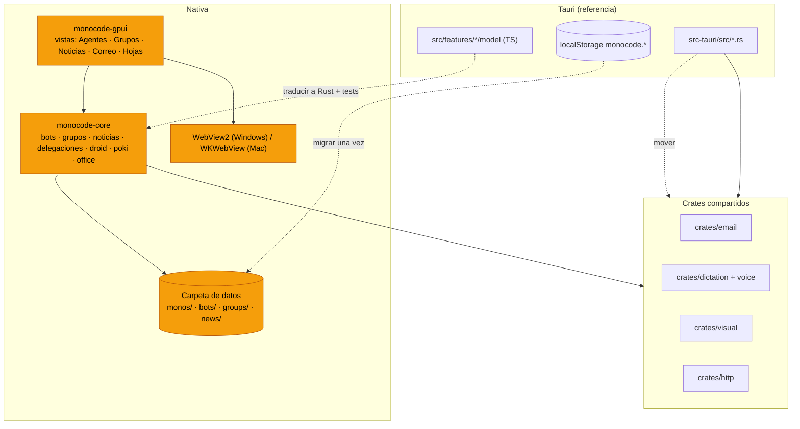

# Plan: llevar MonoBOT a la app nativa (GPUI)

Inventario: los 89 commits de Crhistian Cornejo desde el 4 de noviembre de 2026
(unas 180.000 líneas), más el trabajo sin guardar de visuales y documentos
(`crates/visual`, `src/features/visuals`, `src/features/files/model/pptx.ts`).
Referencia de comportamiento: la app Tauri (`src/`, `src-tauri/`). Destino:
`crates/monocode-core` (lógica) y `crates/monocode-gpui` (interfaz).

## Cómo está hoy

- La nativa es Rust de punta a punta. No comparte código con Tauri: `monocode-core`
  está fuera del workspace de Tauri y `src-tauri` no depende de él.
- Casi toda la lógica de bots, grupos, noticias y delegaciones vive en TypeScript
  (`src/features/*/model`, `src/integrations/harness`) y guarda su estado en
  `localStorage` (`monocode.botNews`, `monocode.delegations.v`, `monocode.groupLearned`…).
  La nativa solo lee ese `localStorage`, y no lo escribe.
- Ya existen como crates de Rust independientes y se pueden enlazar tal cual:
  `crates/email` (IMAP/SMTP, triage, caché), `crates/dictation`, `crates/voice`,
  `crates/visual`, `crates/http` y `crates/mobile-link`.
- La nativa ya tiene: Monos con alma, memoria, hábitos y latido; orquestación;
  documentos; visuales; Inbox de GitHub, GitLab, Jira y Linear; notas;
  automatizaciones; 11 proveedores (Droid no está); skills de `.agents/skills`
  y `.claude/skills`; terminal propia (alacritty).
- Compila y arranca en Windows (comprobado el 5 de noviembre: 13 min la primera vez).

## Reglas para cada función portada

1. La lógica TS de `model/` pasa a Rust en `monocode-core`, sin GPUI. Sus tests
   `*.test.ts` se traducen a `#[test]` con los mismos casos.
2. La interfaz pasa a una vista GPUI en `monocode-gpui`, con los tokens del tema
   (sin colores fijos, con el acento que elige el usuario).
3. El estado compartido se guarda en archivos o en SQLite dentro de la carpeta de
   datos, nunca en `localStorage`, para que Tauri y la nativa vean lo mismo
   durante la transición.
4. Cada función se comprueba en Windows y en macOS, y en los dos diseños (Clásico y Enfocado).
5. Los nombres visibles dicen MonoBOT. Los identificadores internos se quedan:
   `com.monocode.desktop`, `monocode.*` y los nombres de los crates.
6. `pnpm native:check` en verde antes de cada commit, sin avisos.

## Diagrama

*Naranja = nuevo o modificado. Líneas punteadas = trabajo de port.*

## Fases

Cada fase indica qué commits cubre y dónde va el trabajo. Las fases 0 y 1 van
primero; de la 2 a la 9 se pueden repartir en sesiones paralelas porque tocan
archivos distintos.

### Fase 0: cimientos (bloquea lo demás)

| Tarea | Dónde |
| --- | --- |
| Añadir `crates/email`, `dictation`, `voice`, `visual` y `http` al workspace nativo y como dependencias de `monocode-core` | `crates/monocode-gpui/Cargo.toml` |
| Paneles HTML en Windows con WebView2 (`webview2-com`), igual que WKWebView en Mac. Lo necesitan visuales, correo, documentos y hojas | `monocode-gpui/src/monos/html.rs`, plataforma Windows |
| Notificaciones nativas en Windows (toast) | `monocode-gpui/src/notifications/platform.rs` |
| Cero avisos en Windows (los 18 de hoy) y CI que compile la interfaz en Windows | `.github/workflows`, `notifications`, `terminal.rs` |
| Almacén compartido: carpeta `bots/`, `groups/` y `news/` junto a `monos/`, más migración única desde `localStorage` en Tauri | `monocode-core/src/mono`, `src/features/bots/model` |
| Certificados del almacén de Windows en todas las descargas (`c9a96720`) | `crates/http` desde core |

### Fase 1: nombre y estilo

| Commit | Qué |
| --- | --- |
| `eeca5c76` `fb5d7854` `d6e2bca4` `40a85edd` | MonoBOT en todo lo visible: título de ventana (hoy «Monocode Native»), `.app`, menús, ajustes, notificaciones, CLI que ejecutan los agentes |
| `5b15a18e` `87224ca2` `747f9c87` | Estilo de Factory adaptado: sin bordes, esquinas redondeadas, superficies sólidas en lo que se abre encima, acento del usuario. Pasar los tokens de `src/styles/index.css` a `theme.rs` |
| `63d9da70` `4fa65e6d` | Zonas Code y Agentes con su icono |
| `acf8f136` `05617f89` | Brillo del acento al arrastrar un panel más allá del límite; borde que se ilumina mientras escribe la IA |
| `a9b7810b` `7d878b6c` `576c129b` `dadf87c9` `ff912e1f` `fedd4452` | Barra de título en Windows, diseño Enfocado, Archivos y Terminal detrás de un botón de menú, chat de la barra de menú compacto |

### Fase 2: proveedores y sesiones

| Commit | Qué |
| --- | --- |
| `9b47dbb0` | Droid como proveedor: es ACP (`droid exec -o acp`), así que basta con añadirlo a la lista de proveedores ACP del core, con su catálogo y su icono. Uso de todos los planes instalados |
| `7f52394d` `5908e196` | Listar solo los modelos que da la CLI y decir por qué si no hay ninguno; SWE‑2 Flash en Devin |
| `6fce9e8d` | Reintentar el turno solo cuando el proveedor está saturado o se cae la conexión |
| `7bf2490c` `40413445` | Enviar un mensaje más tarde |
| `59fa2ee2` | Mantener el equipo despierto mientras trabajan los agentes |
| `6cc85134` `5c67028e` | Conectores MCP integrados en los turnos de Claude; OpenAlex |
| `e9e302ea` `8443adbb` | Respuesta palabra por palabra con animación, fuentes citadas, aviso de traspaso más corto |
| `c6865c82` | Impedir que los bots ejecuten comandos destructivos |
| `7e27c5fb` | Volumen de los sonidos |

### Fase 3: skills

| Commit | Qué |
| --- | --- |
| `3cd2957b` `8384314a` `54e01193` `936a0ed9` | Incluir en la app los 7 paquetes de `src/features/skills/bundled` (monobot, audio, design, dev, finance, imagery, openai) como raíz «bundled» en `monocode-core/src/skills.rs`; ofrecer las skills de documentos de Anthropic |
| `519f63e3` `3a1eb6be` | Herramientas de agente: leer páginas web, descargar archivos, buscar en tres índices de papers, informe final de investigación |

### Fase 4: bots (agentes especializados)

Traducir `src/features/bots/model/*` y `src/features/agent-app` al core.

| Commit | Qué |
| --- | --- |
| `fc17c214` `22232125` `faa82c01` | Sección Bots y zona Personal/Agentes, separada del espacio de código |
| `d496191b` `f0703c79` `8dad79f1` | Especialidad con sus propias herramientas, memoria de equipo, elegir herramientas, invitar un bot propio, carpetas de acceso y conectores por bot |
| `4f395546` `b5833556` | El Principal dirige a los bots; subagentes para todos |
| `db940cda` `98dcf3ca` | Mensajes entre agentes; despertadores que se ponen ellos mismos (endpoints de control de la app) |
| `be7ee313` `cca6b54c` | Estado de los informes de hábitos y parada de los que fallan; resumen diario del orquestador |
| `224431ba` `20d8d124` `73f59af1` | Exportar e importar bots; sincronizar con una carpeta compartida entre Windows y Mac; modelo y permisos incluidos |
| `95e9b512` `3a1eb6be` | Documentos por tema con nombre puesto por un modelo pequeño; archivos que hizo cada bot |
| `468bec43` | Lector de papers: PDFs en Documentos con los pasajes citados (la nativa ya tiene una parte; reconciliar) |

### Fase 5: noticias

| Commit | Qué |
| --- | --- |
| `fe47aa2e` `5e56c529` `784cec0d` `906d097e` | Noticias de los bots: tarjeta, informe en Markdown, iconos de las fuentes, firmar con la cara del bot, abrir donde se publicó, filtros en una fila, resumen al pasar el ratón, copiar y guardar como nota |

### Fase 6: grupos

Traducir `src/features/groups/model/*` (rondas, asientos, menciones, actividad, aprendizaje y llamadas).

| Commit | Qué |
| --- | --- |
| `4db399b0` `f7460a48` | Grupos como proyectos liderados por el Principal, con carpetas, peticiones de acceso y actividad de cada miembro |
| `c4269799` `54e01193` | Chat de equipo: responde cada miembro y el Principal resume; un asiento para cada miembro |
| `e5bd9996` | `@Nombre` en cualquier parte del mensaje |
| `b1f73c56` | Tarjetas en vivo de los miembros que están trabajando |
| `b306d9b2` | Llamadas de voz en grupo (`crates/voice`) |

### Fase 7: correo

`crates/email` ya hace IMAP, SMTP, triage, caché y búsqueda. Falta enlazarlo y hacer la interfaz.

| Commit | Qué |
| --- | --- |
| `6f161a44` `d6d6de3b` `b42c06f7` | Pestaña de correo en el Inbox: leer, ordenar, responder; abrir al instante y leer por adelantado; arte de Echo en glifos |
| `6419e4c6` `6f6c8cae` | Vista previa de adjuntos, imágenes al abrir, respuestas en streaming (necesita WebView2 en Windows) |
| `efc3be38` | De quién y para quién, con caras; asunto escrito por la IA |
| `201d9abe` `936a0ed9` | Los agentes leen el correo y dejan borradores; el bot de finanzas aprende qué buzón leer y dónde anotar |

### Fase 8: teléfono (Poki)

| Commit | Qué |
| --- | --- |
| `7dafe9e3` `b57856ef` | Bot de teléfono que usa el iPhone a través de Poki, pidiendo permiso antes de cada acción; instalar y lanzar Poki desde el interruptor del iPhone |

### Fase 9: archivos, documentos y visuales

| Commit | Qué |
| --- | --- |
| `45abaae6` `5232eff4` | Hojas de cálculo junto al chat, con fórmulas, imágenes y gráficos, y pestañas con scroll. Decidir entre lector Rust (`calamine` más render GPUI) o WebView |
| sin commit | Presentaciones y documentos (`pptx.ts`, `document.ts`, `DocumentView.tsx`) |
| `70fe70f1` | Gráficos y explicaciones en línea con relleno tramado: unificar con los visuales nativos a través de `crates/visual` |

### Fase 10: dictado y voz

| Commit | Qué |
| --- | --- |
| `67759dd4` `2da0d411` `ef96600c` `a99fe1bc` `43308a3b` | Dictado local en los compositores (sherpa‑onnx), modelo tomado de Echo, descarga detrás de proxy, permiso de micrófono en macOS |

### Fase 11: workstreams

| Commit | Qué |
| --- | --- |
| `5e9c5745` `87224ca2` | Orquestador que lanza agentes en worktrees y abre PRs |

### Fase 12: paso a producción

- Instalador de Windows (MSI o NSIS), firma y notarización en Mac, actualizador.
- Leer el `localStorage` real de WebView2 en Windows (hoy solo hay fixtures).
- Comprobar que Tauri y la nativa conviven sin pisar los datos, y luego retirar Tauri.

## Lo que no se porta

- `d4c53c31` (npm → pnpm), `11b94fc2`, `a40dd243`, `d89bbcfe`: herramientas y tests de la parte web.
- `e597b549`, `235b3d5f`: el puente entre la terminal de Tauri y la GPU. La nativa ya
  usa alacritty y vigilancia de archivos propia.
- `2b0c8d48`: ya está en el core.
- `b23285cc`: documentación.

## Orden y paralelismo

1. Fase 0, y luego la fase 1, en esta sesión: todo lo demás depende de ellas.
2. Fases 2 y 3 juntas: son pequeñas y desbloquean a los bots.
3. Fase 4 antes de las fases 5, 6 y 8, que se apoyan en el modelo de bots.
4. Las fases 7, 9 y 10 son independientes: pueden ir en sesiones paralelas desde que termina la fase 0.
5. Fase 11 cuando se quiera; fase 12 al final.

## Decisión abierta

Mientras dure el port, cada función nueva que se añada a Tauri hay que hacerla dos
veces. Opciones: congelar las funciones nuevas en Tauri, o mantener la regla de
que cualquier función nueva pone su lógica en Rust compartido desde el principio.
